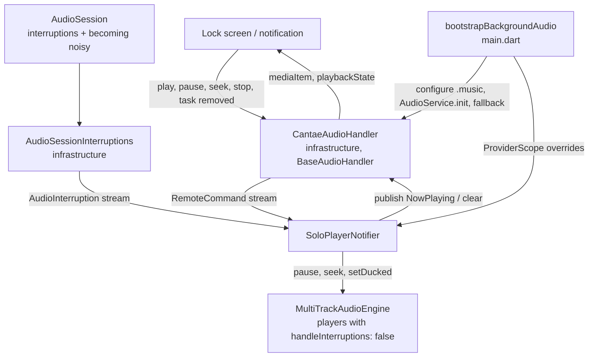

# Áudio em segundo plano Design

**Spec**: `.specs/features/background-audio/spec.md`
**Status**: Approved

---

## Architecture Overview

Two narrow domain contracts sit between the Modo solo notifier and the OS:

- **`PlaybackRemote`** carries "now playing" outward (title, duration, playing, position) and remote commands inward (play, pause, seek, stop).
- **`AudioInterruptions`** turns OS audio-session events into a small domain enum.

`SoloPlayerNotifier` is the only consumer. Remote commands go through the same `togglePlay`/`seekTo` paths as the in-app buttons (BGA-07/08), so there is no second playback path to keep in sync.

### Approaches considered

| Approach | Verdict |
| -------- | ------- |
| **A. New domain contracts + a new solo-facing handler** (above) | **Chosen.** The notifier stays testable with fakes. Remote and in-app taps share one code path. Interruptions pause all tracks together. |
| B. Extend the phase-4 `BackgroundAudioHandler` (room, broadcaster-based) with a solo mode | Rejected. It mixes room role-gating with solo. It talks to `MultiTrackAudioEngine` directly, bypassing the notifier, so the screen state would drift from the audio. |
| C. Keep `just_audio`'s built-in interruption handling and only add the handler | Rejected. `just_audio` 0.9.46 auto-resumes each player after a pause interruption (`just_audio.dart:337-338`), which contradicts BGA-11. It also acts per player, so the notifier would never learn of the pause (BGA-14). |

---

## Code Reuse Analysis

### Existing Components to Leverage

| Component | Location | How to Use |
| --------- | -------- | ---------- |
| Android foreground service + `MediaButtonReceiver` | `android/app/src/main/AndroidManifest.xml:3-60` | Keep as-is (BGA-03 Android half) |
| `MainActivity : AudioServiceActivity` | `android/app/src/main/kotlin/.../MainActivity.kt` | Keep as-is |
| `SoloPlayerNotifier.togglePlay` / `seekTo` / `dispose` | `lib/presentation/providers/solo_player_notifier.dart:291-313, 502-507` | Remote commands call these; `dispose` also clears the remote |
| `SoloPlayerNotifier._onPosition` loop / end branches | `solo_player_notifier.dart:261-279` | Publish after a loop jump and at the end of the song |
| `MultiTrackAudioEngine` gain path (`baseGain * volume`) | `lib/infrastructure/audio/multi_track_audio_engine.dart` | Add a duck factor to the same gain computation |
| `Toast.show` | `lib/presentation/widgets/toast.dart` | Toasts for an external pause (BGA-14) |
| `ClickTrackWav.encode` | `lib/infrastructure/audio/click_track_wav.dart` | Integration test writes its 2 test tracks as WAV without assets |
| Fake `just_audio` platform | `test/infrastructure/audio/fakes/fake_just_audio_platform.dart` | Engine tests for `setDucked` |

### Integration Points

| System | Integration Method |
| ------ | ------------------ |
| `audio_service` 0.18.19 | `AudioService.init<CantaeAudioHandler>(builder:, config:)` once in `main` (`audio_service.dart:1002`); the handler extends `BaseAudioHandler` (`:2971`) |
| `audio_session` 0.1.25 | `AudioSession.instance` → `configure(AudioSessionConfiguration.music())` (`core.dart:548`, category `.playback`); `interruptionEventStream`, `becomingNoisyEventStream` (`core.dart:186`) |
| `just_audio` 0.9.46 | `AudioPlayer(handleInterruptions: false)` (`just_audio.dart:188`) so the notifier owns interruption policy |
| Riverpod | Two new providers with no-op defaults; `main` overrides them with the real implementations |
| iOS | `ios/Runner/Info.plist` gains `UIBackgroundModes` → `audio` |

---

## Components

### `PlaybackRemote` + `NowPlaying` + `RemoteCommand` (domain)

- **Purpose**: Contract for publishing what is playing to the OS and receiving its transport commands.
- **Location**: `lib/domain/audio/playback_remote.dart`
- **Interfaces**:
  - `void publish(NowPlaying info)`: title, subtitle, `durationMs`, `playing`, `positionMs`.
  - `void clear()`: no song; the notification goes away.
  - `Stream<RemoteCommand> get commands`: a sealed type with `RemotePlay`, `RemotePause`, `RemoteSeek(int ms)` and `RemoteStop`.
- **Also**: `NoPlaybackRemote`, a no-op default used by tests that do not care and as the fallback when `AudioService.init` fails (BGA-18).
- **Dependencies**: none (pure Dart, AD-001).

### `AudioInterruption` + `AudioInterruptions` (domain)

- **Purpose**: OS audio events reduced to what the player needs.
- **Location**: `lib/domain/audio/audio_interruptions.dart`
- **Interfaces**:
  - `enum AudioInterruption { pauseBegan, pauseEnded, duckBegan, duckEnded, headphonesDisconnected }`
  - `Stream<AudioInterruption> get events`
  - `NoAudioInterruptions`: a no-op default.

### `AudioSessionInterruptions` (infrastructure)

- **Purpose**: Maps `audio_session` streams to `AudioInterruption`.
- **Location**: `lib/infrastructure/audio/audio_session_interruptions.dart`
- **Mapping**:
  - `begin` with `pause` or `unknown` → `pauseBegan`; `end` with `pause` → `pauseEnded`.
  - `begin` with `duck` → `duckBegan`; `end` with `duck` → `duckEnded`.
  - `end` with `unknown` emits nothing.
  - "Becoming noisy" → `headphonesDisconnected`.
- **Interfaces**: constructor takes the two raw streams, so tests feed them directly; `static Future<AudioSessionInterruptions> fromSession(AudioSession)`.

### `CantaeAudioHandler` (infrastructure)

- **Purpose**: The single `audio_service` handler. Implements `PlaybackRemote` and turns OS callbacks into `RemoteCommand`s.
- **Location**: `lib/infrastructure/audio/cantae_audio_handler.dart`
- **Interfaces**:
  - `publish` sets:
    - `mediaItem` = `MediaItem(id: 'solo', title:, artist: subtitle, duration:)`;
    - `playbackState` = controls `[play]` or `[pause]`, `systemActions {MediaAction.seek}`, `androidCompactActionIndices [0]`, `processingState ready`, `playing`, `updatePosition`.
  - Only these controls are offered (BGA-09).
  - `clear` sets `mediaItem` null and `playbackState` idle, not playing. This stops the Android foreground service.
  - `play()` → `RemotePlay`; `pause()` → `RemotePause`; `seek(d)` → `RemoteSeek(d.inMilliseconds)`; `stop()` and `onTaskRemoved()` → `RemoteStop`.
- **Reuses**: `BaseAudioHandler`, which is plain Dart (BehaviorSubjects), so it is testable under `flutter test` without a platform channel.

### `bootstrapBackgroundAudio` (infrastructure / app start)

- **Purpose**: Configure the audio session, register the handler and return the provider overrides. Never block app start (BGA-01, BGA-02, BGA-18).
- **Location**: `lib/infrastructure/audio/background_audio_bootstrap.dart`. `main.dart` becomes `async` and calls it before `runApp`.
- **Interfaces**: `Future<List<Override>> bootstrapBackgroundAudio({Future<CantaeAudioHandler> Function()? initService, Future<AudioInterruptions> Function()? interruptions})`.
- **On any failure**: catches it and leaves that provider at its no-op default.

### Providers (presentation)

- **Location**: `lib/presentation/providers/background_audio_providers.dart`
- `playbackRemoteProvider = Provider<PlaybackRemote>((_) => const NoPlaybackRemote())`
- `audioInterruptionsProvider = Provider<AudioInterruptions>((_) => const NoAudioInterruptions())`

### `SoloPlayerNotifier` changes

**Publishing (BGA-05/06):** `_publish()` sends `NowPlaying(title: song.title, subtitle: 'Modo solo', durationMs, playing, positionMs)` at:
- ready;
- `togglePlay` (both directions);
- `seekTo`;
- a loop jump;
- the end of the song;
- an interruption pause.

It is not sent on every position tick: `audio_service` derives the position from `updatePosition` + speed (`audio_service.dart:200`).

**Commands (BGA-07/08/10):**
- `RemotePlay` and `RemotePause` call `togglePlay()` only when it changes the state, so a "Pausar" while paused is a no-op.
- `RemoteSeek` calls `seekTo`.
- `RemoteStop` pauses and calls `clear()`.
- `dispose` calls `remote.clear()` and cancels both subscriptions.

**Interruptions (BGA-11/12/13):**
- `pauseBegan`, or `headphonesDisconnected` while playing: `playing: false`, `externalPause: interruption | headphones`, `_engine.pause()`, publish.
- `pauseEnded`: nothing (no auto-resume).
- `duckBegan` / `duckEnded`: `_engine.setDucked(true/false)`.
- If `_engine.pause()` throws: restore `playing: true` and do not set `externalPause` (BGA-14 / P3-AC6).

**New state:** `ExternalPause? externalPause`, with `enum ExternalPause { interruption, headphones }`, plus `void acknowledgeExternalPause()`.

### `SoloPlayerScreen` changes

- `ref.listen` on `externalPause`.
- If the app is resumed, show the toast now; otherwise wait for `AppLifecycleListener.onResume`.
- Then call `acknowledgeExternalPause()`.
- Texts: "Música pausada: outro áudio começou" and "Música pausada: fone desconectado".

### `AudioPlaybackEngine.setDucked(bool)` (domain interface + `MultiTrackAudioEngine`)

- Gain becomes `baseGain * volume * (ducked ? 0.5 : 1)` for every track, including the click.
- Default player factory becomes `() => AudioPlayer(handleInterruptions: false)`.
- The test fakes (7) implement `setDucked`.

### Device verification artifacts

- `docs/device-test-background-audio.md`: numbered pt-BR script, with an expected result per step (BGA-15).
- `integration_test/background_audio_test.dart`:
  - writes 2 WAV tracks with `ClickTrackWav.encode`;
  - pumps `SoloPlayerScreen` with overrides, using a `playerFactory` that captures the real `AudioPlayer`s;
  - taps "Tocar" and waits 2 s;
  - logs `playing` for each player plus the position delta to `integration_test/out/background_audio.log` and stdout (BGA-16).

---

## Error Handling Strategy

| Error Scenario | Handling | User Impact |
| -------------- | -------- | ----------- |
| `AudioService.init` throws (plugin or config error) | Caught in bootstrap; `NoPlaybackRemote` stays | App opens; Modo solo plays in the foreground; no notification (BGA-18) |
| `AudioSession.configure` throws | Caught in bootstrap; continues | Plays with the platform default session; background on iOS may stop (device script checks) |
| Engine pause throws on an interruption | Notifier restores `playing: true`, no `externalPause` | Screen keeps showing "Pausar" matching what is audible (P3-AC6) |
| Remote command arrives while not ready (loading / error) | `togglePlay`/`seekTo` already return early unless `ready` | Nothing happens |
| Remote seek past the end | `seekTo` clamps to 0–duration | Same as dragging in-app |

---

## Risks & Concerns

| Concern | Location (file:line) | Impact | Mitigation |
| ------- | -------------------- | ------ | ---------- |
| Two `audio_service` handlers in the codebase: the phase-4 room `BackgroundAudioHandler` and the new `CantaeAudioHandler`; `audio_service` allows one `init` per process | `lib/infrastructure/audio/background_audio_handler.dart:44` | When room screens land, two handlers would compete | Only `CantaeAudioHandler` is registered in `main`. The room handler stays (used by the phase-4 integration test) and is recorded in STATE.md as debt to fold into `PlaybackRemote` with the room UI |
| `handleInterruptions: false` cannot be observed under `flutter test` (no getter, no fake session) | `multi_track_audio_engine.dart:49` | A regression back to auto-resume would pass CI | Covered by the device script (call → stays paused). The factory is a named static so a review sees it; listed as device-only in validation |
| Background lifetime on iOS / Android is OS behavior | platform | Cannot be proven on the desktop | Device script + integration test; pending run recorded in STATE.md (BGA-17) |
| `androidStopForegroundOnPause: true` (default) lets Android kill the process while paused in the background | `AudioServiceConfig` | Paused for a long time in the background → the app may restart on return | Accepted (standard media-app behavior, frees resources); listed in the device script so it is observed, not assumed |
| Duck on iOS is rarely emitted (iOS mixes audio itself) | `audio_session` | BGA-12 may never trigger on iOS | Fine: the requirement is "do not pause on a short sound", which holds either way |

---

## Tech Decisions (only non-obvious ones)

| Decision | Choice | Rationale |
| -------- | ------ | --------- |
| Who owns interruption policy | The notifier, via a domain stream; `just_audio` per-player handling off | One pause for all tracks + click, no auto-resume, and the screen knows (BGA-11/14) |
| Duck amount | 50 % of the current gain | Same factor `just_audio` uses by default (`just_audio.dart:312-318`) |
| Position publishing | On discrete events only | `audio_service` extrapolates position from `updatePosition` while playing; continuous updates are explicitly discouraged (`audio_service.dart:200`) |
| No-op defaults for both providers | `NoPlaybackRemote`, `NoAudioInterruptions` | Existing screen/notifier tests keep working without overrides; the real wiring happens only in `main` |
