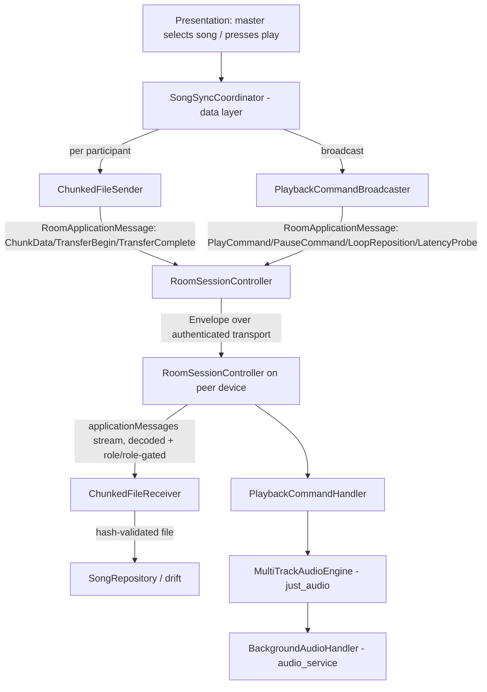

# File Transfer & Synchronized Playback Design

**Spec**: `.specs/features/file-transfer-and-sync-playback/spec.md`
**Status**: Approved

---

## Architecture Overview

The feature adds one new logical layer on top of the already-verified session/networking stack (Phase 3): an **application-message sub-protocol** carried inside the existing `Envelope.payload` bytes. No change to `Envelope`, `EnvelopeAuthenticator`, `SessionTransport`, or the wire framing (`frame_codec.dart`) is needed — those already give authenticated, ordered, replay-safe, role-gated delivery per connection. This feature defines *what's inside the envelope*, not a new transport.

Two new domain/data concerns ride on top of that channel:

1. **Chunked file transfer** — master → each participant, one song's tracks at a time, resumable.
2. **Synchronized playback commands** — master → all participants, latency-compensated play/pause/loop.

A third piece, outside the network path, makes the audio actually play: a **multi-track audio engine** (`just_audio` per track) driven by the existing pure domain math (`AudioMixCalculator`, `LoopController`, `TimelineConverter`), wrapped by `audio_service` for background/lock-screen control.



---

## Approach Exploration: how to carry the new protocol

Three viable approaches for getting chunk/playback messages between devices. All three satisfy every AC; they differ in risk and reuse.

### Option A — New sub-protocol inside `Envelope.payload` on the existing single connection (Recommended)

Define a new tag-prefixed message family (`RoomApplicationMessage`, mirroring the existing `SessionWireMessage` encode/decode style) that lives entirely *inside* the already-authenticated `payload` bytes. The sender alternates: send the next 64 KiB file chunk, then flush any queued control message (play/pause/latency-probe), repeat — so a control message is never blocked behind more than one chunk's transmission (sub-millisecond to a few ms on LAN, negligible against the 100 ms budget).

- **Pros**: Zero changes to the verified Phase 3 session layer (transport, authenticator, framing, state machine). Reuses HMAC + sequence + replay protection + `requiresMasterRole` gating for free — file chunks and play commands get the same forgery/replay protection NET already proved. Smallest surface area to test.
- **Cons**: Large file transfer and latency-sensitive playback commands share one TCP stream per participant; worst-case control-message delay is bounded by one chunk's send time, not zero.
- **Risk**: Low — the sharing cost is bounded and small relative to the 100 ms target.

### Option B — Second dedicated TCP connection per participant for bulk file bytes

Open a second authenticated socket per participant purely for chunk data, keeping the first connection free for low-latency playback control.

- **Pros**: Removes even the bounded head-of-line delay from Option A.
- **Cons**: Doubles connection lifecycle management (two handshakes, two reconnection paths, two sets of sequence counters per participant) inside `RoomSessionController`, which Phase 3 closed and verified with a PASS Verifier report. Reopening it risks regressing a feature that's already done, for a latency win that's already negligible at 64 KiB chunks.
- **Risk**: Medium-high — not the connection logic itself, but the chance of destabilizing verified Phase 3 behavior (reconnect, TTL, role gating) while threading a second channel through it.

### Option C — UDP side-channel for playback commands only

Use UDP (connectionless) for play/pause/latency-probe, keep TCP for file chunks.

- **Pros**: Lowest theoretical latency for control messages.
- **Cons**: UDP has no delivery guarantee — a dropped play command needs its own retry/ack logic, duplicating what the existing TCP+envelope stack already gives for free. Introduces a second transport implementing `SessionTransport`'s authenticated-envelope contract from scratch, on a LAN where the latency difference vs. Option A is not measurable at the 100 ms target.
- **Risk**: Medium — not technically hard, but solves a latency problem that doesn't exist yet, at the cost of a second security-sensitive transport to get right.

**Recommendation: Option A.** The 64 KiB chunk size (already an Assumption in the spec) keeps worst-case control-message delay under roughly a millisecond on a LAN — three orders of magnitude under the 100 ms budget. Reusing the verified Envelope/transport stack as-is is the single biggest risk reduction available in this feature.

---

## Code Reuse Analysis

### Existing Components to Leverage

| Component | Location | How to Use |
| --- | --- | --- |
| `Envelope` / `EnvelopeAuthenticator` | `lib/domain/session/envelope*.dart` | Unchanged — every new message type is signed/verified exactly like Phase 3 messages, including replay detection and `requiresMasterRole`. |
| `SessionTransport` / `TcpSessionTransport` | `lib/domain/session/session_transport.dart`, `lib/infrastructure/network/tcp_session_transport.dart` | Unchanged — same `send`/`receive` per-participant byte streams carry the new payloads. |
| `SessionWireMessage` + `frame_codec.dart` | `lib/data/session/session_wire_message.dart`, `frame_codec.dart` | Pattern reused (tag byte + length-prefixed fields) for the new `RoomApplicationMessage` family; framing itself (length-prefixed frames) is reused unchanged. |
| `RoomSessionController` | `lib/data/session/room_session_controller.dart` | Extended (not replaced) with a decoded-payload broadcast stream and master-side broadcast/send-to-one helpers (see Risks & Concerns — this gap exists today). |
| `AudioMixCalculator` | `lib/domain/audio/audio_mix_calculator.dart` | Drives per-track gain (own naipe vs. choir) fed into `MultiTrackAudioEngine`; untouched pure math, just finally has a caller. |
| `LoopController` | `lib/domain/audio/loop_controller.dart` | Drives loop-reposition scheduling; untouched. |
| `TimelineConverter` | `lib/domain/audio/timeline_converter.dart` | Converts shared timeline position to each track's local offset (tracks can have `startDelayMs`); untouched. |
| `SongRepository` / `DriftSongRepository` | `lib/domain/repositories/song_repository.dart`, `lib/data/repositories/drift_song_repository.dart` | A received, hash-validated file becomes a `SongTrack.filePath` update through the existing repository — no schema change. |
| `Result<S, F>` / `Failure` subclasses | `lib/domain/core/` | All new domain operations (chunk planning, hash validation, transfer/playback state transitions) follow AD-002, no `throw`. |
| `path_provider` | already in `pubspec.yaml` (AD-004), unused until now | First consumer: resolves the app-sandbox documents directory as the root for received files. |

### Integration Points

| System | Integration Method |
| --- | --- |
| Session/networking (Phase 3) | New `RoomApplicationMessage` payloads flow through the same per-participant connection, same Envelope signing/verification. |
| Local database (Phase 2, drift) | `SongRepository.updateTrack`/equivalent sets `filePath` once a transferred file's hash validates; no new tables. |
| `just_audio` / `audio_service` | New infrastructure component (`MultiTrackAudioEngine`, `BackgroundAudioHandler`) — first real use of these two already-declared dependencies. |

---

## Components

### `RoomApplicationMessage` (new)

- **Purpose**: Tag-prefixed encode/decode for the application-level messages carried inside `Envelope.payload` — the "what's inside the envelope" this feature adds.
- **Location**: `lib/data/session/room_application_message.dart`
- **Interfaces**:
  - `Uint8List encode()`
  - `static RoomApplicationMessage decode(Uint8List bytes)`
  - Variants: `TransferBeginMessage(songId, trackId, totalSizeBytes, sha256Declared, chunkSize)`, `ChunkDataMessage(trackId, chunkIndex, bytes)`, `ChunkAckMessage(trackId, chunkIndex)`, `TransferCompleteMessage(trackId, accepted, failureCode?)`, `PlayCommandMessage(songId, masterSendEpochMs)`, `PauseCommandMessage(masterSendEpochMs)`, `StopCommandMessage(masterSendEpochMs)`, `LoopRepositionMessage(masterSendEpochMs)`, `LatencyProbeMessage(probeId, masterSendEpochMs)`, `LatencyProbeReplyMessage(probeId)`, `PlaybackSnapshotMessage(songId?, state)` (sent to a (re)connecting participant so it knows whether to show "waiting").
- **Dependencies**: none beyond `dart:typed_data`/`dart:convert` (same style as `SessionWireMessage`).
- **Reuses**: the length-prefixed field encoding helpers already in `session_wire_message.dart` (`_withU16LenString`/`_readU16LenString` pattern, extended with a `_withU32LenBytes` for chunk payloads).

### `RoomSessionController` extension (modified, not replaced)

- **Purpose**: Close the gap where verified envelope payloads are currently authenticated and then silently dropped (see Risks & Concerns).
- **Location**: `lib/data/session/room_session_controller.dart`
- **New interfaces**:
  - `Stream<(ParticipantId sender, Uint8List payload)> get applicationMessages` — emitted after `acceptEnvelope`/`_authenticator.verify` succeeds, both on the master side (per connected participant) and the visitor side (from master). Rejected/invalid envelopes never reach this stream — role/replay/HMAC gating happens exactly where it does today.
  - Master side: `Future<Result<Unit, Failure>> sendEnvelopeTo(ParticipantId participant, Uint8List payload, {bool requiresMasterRole})` and `Future<void> broadcastEnvelope(Uint8List payload, {bool requiresMasterRole})` (loops connected participants) — today only the visitor side has a `sendEnvelope`; the master side has no symmetric helper.
- **Dependencies**: unchanged (`EnvelopeAuthenticator`, `RoomSessionStateMachine`).
- **Reuses**: existing per-connection sequence counters and the existing `_handleMasterMessage`/`_handleVisitorMessage` dispatch — this is additive, those methods gain one more branch that decodes `RoomApplicationMessage` and republishes it on the new stream instead of discarding it.

### `ChunkPlanner` (new, domain)

- **Purpose**: Pure math for splitting a file into chunks and computing the resume offset — no I/O.
- **Location**: `lib/domain/transfer/chunk_planner.dart`
- **Interfaces**:
  - `static int chunkCount({required int totalSizeBytes, required int chunkSize})`
  - `static int resumeFromChunkIndex({required int lastAckedChunkIndex})` (returns `lastAckedChunkIndex + 1`, or `0` if `lastAckedChunkIndex < 0`)
  - `static bool exceedsMaxSize(int totalSizeBytes)` (100 MB cap, per spec Edge Cases)
- **Dependencies**: none.
- **Reuses**: nothing — this is the one genuinely new piece of domain math the feature needs.

### `FileTransferState` (new, domain)

- **Purpose**: Typed state for one track's transfer to one participant (`pending → inProgress → validating → available` / `failed`), with guarded transitions (AD-002 style, `Result`-returning).
- **Location**: `lib/domain/transfer/file_transfer_state.dart`
- **Interfaces**:
  - `Result<FileTransferState, TransferFailure> advance(TransferEvent event)`
- **Dependencies**: none.
- **Reuses**: `Result`/`Failure` pattern (AD-002).

### `ChunkedFileSender` (new, data)

- **Purpose**: Master-side orchestration — reads a local file, drives the `TransferBegin → ChunkData (with retry, bounded 5 attempts) → TransferComplete` sequence for one participant, honoring a resume offset if the participant reports one.
- **Location**: `lib/data/transfer/chunked_file_sender.dart`
- **Interfaces**:
  - `Future<Result<Unit, Failure>> sendTrack({required SongTrack track, required ParticipantId to, required int resumeFromChunkIndex})`
- **Dependencies**: `RoomSessionController.sendEnvelopeTo`, `ChunkPlanner`, `dart:io` file read (infrastructure boundary — this class lives in `data/`, which is allowed to touch `dart:io`; only `domain/` is restricted).
- **Reuses**: `ChunkPlanner`, `RoomApplicationMessage`.

### `ChunkedFileReceiver` (new, data)

- **Purpose**: Participant-side orchestration — listens on `applicationMessages` for this track's `ChunkData`, writes each chunk to a `.partial` file in the app-sandbox library root, ACKs it, and on `TransferComplete` (or its own last-chunk detection) computes SHA-256 and either promotes the file into the library or discards + retries (bounded to 2 whole-track retries, per spec).
- **Location**: `lib/data/transfer/chunked_file_receiver.dart`
- **Interfaces**:
  - `Stream<TransferProgress> receiveTrack({required String trackId, required String expectedSha256, required int totalSizeBytes})`
- **Dependencies**: `RoomSessionController.applicationMessages`, `path_provider` (resolve storage root), `crypto` package (SHA-256, already a declared dependency per AD-011's note distinguishing it from `cryptography`), `SongRepository` (to flip the track's `filePath` once validated).
- **Reuses**: `crypto` package, `SongRepository`.

### `SongSyncCoordinator` (new, data)

- **Purpose**: The single entry point the presentation layer calls — "rehearse this song now." Fans a song's tracks out to every connected participant via `ChunkedFileSender`, enforcing the spec's "one song mid-transfer per room at a time" rule (a second call queues).
- **Location**: `lib/data/transfer/song_sync_coordinator.dart`
- **Interfaces**:
  - `Future<Result<Unit, Failure>> syncSongToRoom(Song song)`
  - `Stream<SongSyncProgress> get progress`
- **Dependencies**: `ChunkedFileSender`, `RoomSessionController` (participant list from `RoomSessionSnapshot`).
- **Reuses**: `RoomSessionSnapshot` (already exists) for the current participant list.

### `LatencyEstimator` (new, domain)

- **Purpose**: Pure function turning a round-trip probe into a one-way delay estimate.
- **Location**: `lib/domain/playback/latency_estimator.dart`
- **Interfaces**:
  - `static int estimateOneWayDelayMs({required int sentAtEpochMs, required int echoedAtEpochMs, required int receivedBackAtEpochMs})` → `(receivedBackAtEpochMs - sentAtEpochMs) ~/ 2`
- **Dependencies**: none.

### `PlaybackCommandBroadcaster` (new, data, master-side)

- **Purpose**: On play/pause/stop/loop-reposition, probes latency for each connected participant (`LatencyProbeMessage`/`LatencyProbeReplyMessage` round trip), computes each participant's scheduled epoch via `LatencyEstimator`, and broadcasts the command with that participant-specific `masterSendEpochMs` baseline.
- **Location**: `lib/data/playback/playback_command_broadcaster.dart`
- **Interfaces**:
  - `Future<void> play(SongId songId)`
  - `Future<void> pause()`
  - `Future<void> stop()`
  - `Future<void> repositionToLoopStart()`
- **Dependencies**: `RoomSessionController.sendEnvelopeTo`/`broadcastEnvelope`, `LatencyEstimator`.

### `PlaybackCommandHandler` (new, data, every device including master's own loopback)

- **Purpose**: Receives `PlayCommandMessage`/etc. from `applicationMessages`, rejects any that didn't arrive with `requiresMasterRole` satisfied (defense in depth — the envelope layer already enforces this; this handler trusts that gate and does not re-derive role from message content), and schedules the actual engine call via `Timer` for the message's target epoch.
- **Location**: `lib/data/playback/playback_command_handler.dart`
- **Interfaces**:
  - `Stream<RoomPlaybackSnapshot> get snapshots` (Idle / Waiting / Scheduled / Playing / Paused)
- **Dependencies**: `MultiTrackAudioEngine`, `RoomSessionController.applicationMessages`.

### `MultiTrackAudioEngine` (new, infrastructure)

- **Purpose**: Owns one `just_audio` `AudioPlayer` per track of the active song; applies `AudioMixCalculator` gains and `TimelineConverter`/`LoopController` seek targets; this is the only place `package:just_audio` is imported.
- **Location**: `lib/infrastructure/audio/multi_track_audio_engine.dart`
- **Interfaces**:
  - `Future<void> loadSong(Song song)`
  - `Future<void> playAt(DateTime scheduledStart)`
  - `Future<void> pause()`
  - `Future<void> stop()`
  - `Future<void> seekAllTo(int timelineMs)`
- **Dependencies**: `just_audio`.
- **Reuses**: `AudioMixCalculator`, `LoopController`, `TimelineConverter` (all pure domain math, called from this infrastructure component — consistent with AD-001: the math stays pure and Flutter-free, only this wrapper touches the plugin).

### `BackgroundAudioHandler` (new, infrastructure)

- **Purpose**: `audio_service`'s `BaseAudioHandler` implementation exposing one logical "song" to the OS (lock screen / notification), delegating play/pause/stop taps back into `PlaybackCommandBroadcaster` so a background tap goes through the exact same role-gated, latency-compensated broadcast path as an in-app tap (P2 AC3).
- **Location**: `lib/infrastructure/audio/background_audio_handler.dart`
- **Interfaces**: standard `BaseAudioHandler` overrides (`play()`, `pause()`, `stop()`).
- **Dependencies**: `audio_service`, `PlaybackCommandBroadcaster`, `MultiTrackAudioEngine`.

---

## Data Models

No new drift tables. Transfer and playback state are session-scoped (live only for the lifetime of the room, same as `RoomSessionStateMachine`'s own state) — consistent with the "local-first, ephemeral session" model; a transfer does not need to survive the app process being killed, only a socket reconnect within the session TTL (Phase 3 already handles the reconnect-and-resume-session case, this feature resumes the *file* on top of that).

```dart
// lib/domain/transfer/file_transfer_state.dart
enum TransferPhase { pending, inProgress, validating, available, failed }

final class FileTransferState {
  final String trackId;
  final ParticipantId participant;
  final TransferPhase phase;
  final int lastAckedChunkIndex; // -1 = none yet
  final int totalChunks;
  final String? failureCode;
}
```

```dart
// lib/domain/playback/room_playback_snapshot.dart
enum PlaybackPhase { idle, waiting, scheduled, playing, paused }

final class RoomPlaybackSnapshot {
  final String? activeSongId;
  final PlaybackPhase phase;
  final DateTime? scheduledStartAt; // only set while phase == scheduled
}
```

**Relationships**: `FileTransferState` is keyed per `(trackId, participant)` on the master side (one per connected device being sent to) and per `trackId` on the receiving side. `RoomPlaybackSnapshot` is one value per device, kept in sync by `PlaybackCommandHandler` reacting to broadcast commands.

On successful validation, `ChunkedFileReceiver` calls into `SongRepository` to persist the final `filePath` for that `SongTrack` row — reusing the existing `songs`/`song_tracks` drift tables unchanged.

---

## Error Handling Strategy

| Error Scenario | Handling | User Impact |
| --- | --- | --- |
| Chunk ACK not received after 5 attempts | `FileTransferState.failed`, surfaced as `NetworkFailure(code: 'transfer.chunk-delivery-failed')` to the master's UI for that participant only; other participants' transfers continue. | Master sees that one device failed to receive the song; can retry manually. |
| Reassembled file hash mismatch | Discard reassembled bytes, retry whole-track transfer (bounded to 2 retries), never expose the file to `SongRepository`. | Receiving device shows "verifying..." longer; after 2 failed retries, a `ValidationFailure(code: 'transfer.hash-mismatch')` surfaces and the track stays absent from that device's library. |
| TCP disconnect mid-transfer, reconnect within TTL | `ChunkedFileSender` asks the receiver (via a `TransferBegin` resent on reconnect) for its `lastAckedChunkIndex`; `ChunkPlanner.resumeFromChunkIndex` picks up from there. | Transfer visibly continues instead of restarting; no user action needed. |
| Declared file size > 100 MB | `SongSyncCoordinator` rejects before sending `TransferBegin`, returns `ValidationFailure(code: 'transfer.file-too-large')`. | Master sees the song can't be synced before any transfer starts, not mid-way. |
| Insufficient storage on receiver | `ChunkedFileReceiver` aborts on first write failure, discards partial file, returns `InfrastructureFailure(code: 'transfer.insufficient-storage')`; does not block the master's other sends. | That device shows a storage error; others in the room are unaffected. |
| Visitor-originated play/pause/seek/loop/transfer-initiate | Rejected at the existing envelope role gate (`requiresMasterRole`) before `PlaybackCommandHandler`/`SongSyncCoordinator` ever see it — same mechanism as Phase 3's `NET` role tests. | No visible effect on any device; silently a no-op, consistent with current visitor UX. |
| OS reclaims audio focus mid-song | `BackgroundAudioHandler` catches the `just_audio` interruption callback, calls `MultiTrackAudioEngine.pause()` locally, surfaces `InfrastructureFailure(code: 'audio.focus-lost')`; does **not** broadcast a pause to the rest of the room. | That one singer's audio pauses; the rest of the room keeps playing — matches spec P2 AC4 ("without corrupting the room's shared playback state for other participants"). |
| Late join / reconnect during active playback | On connect, `RoomSessionController` (master side) sends a `PlaybackSnapshotMessage` reflecting current state; if `playing`, the joining `PlaybackCommandHandler` sets its own snapshot to `waiting` and does not call the engine until the next `PlayCommand`/`LoopReposition`. | Joiner sees a "waiting for next start" UI state instead of a jarring mid-song audio cut-in. |

---

## Risks & Concerns

| Concern | Location (file:line) | Impact | Mitigation |
| --- | --- | --- | --- |
| Verified inbound envelope payloads are authenticated and then discarded — no application-level dispatch hook exists today. | `lib/data/session/room_session_controller.dart:292-305` (master) and `:338-358` (visitor) | Without this fix, nothing this feature sends (chunks, play commands) can ever reach application code on the receiving side. | Design adds `applicationMessages` broadcast stream as an additive change to both dispatch paths (see `RoomSessionController extension` above) — not a rewrite, one more branch per existing `if (message is EnvelopeMessage)` block. |
| Master side has no symmetric `sendEnvelope`/broadcast helper — only the visitor side has one (`sendEnvelope`, line 128). | `lib/data/session/room_session_controller.dart:128-156` | File transfer and play commands both originate from the master; without a send path, the master can authenticate inbound but can't originate outbound application messages. | Design adds `sendEnvelopeTo`/`broadcastEnvelope` on the master side, reusing the same per-connection sequence-numbering the visitor side already does. |
| No existing file-storage convention: `SongTrack.filePath` is just a string set by whatever imported it; `path_provider` is declared but unused (confirmed via grep — no `path_provider`/`Directory` usage anywhere in `lib/`). | `pubspec.yaml:19`, `lib/domain/entities/song_track.dart` | Without a defined app-sandbox root, received files could end up anywhere, violating the project's "app sandbox only" storage rule. | This feature is the first to write files programmatically, so it defines the root now: `getApplicationDocumentsDirectory()/library/tracks/<sha256>.<ext>` (content-addressed, doubles as the dedup key from the spec's Assumptions). Local song import (if/when built) should later reuse the same root — noted for whoever builds that, not blocking this feature. |
| `just_audio`/`audio_service` have zero existing usage in the codebase — first real integration, version-specific API risk. | `pubspec.yaml:15-16` | Wrong assumptions about `BaseAudioHandler`/`AudioPlayer` API surface could propagate into Tasks. | Flagged honestly below (Tech Decisions) — API specifics (exact `AudioPlayer`/`BaseAudioHandler` method signatures for the declared 0.9.x/0.18.x versions) were not independently re-verified against current pub.dev docs in this design pass (Context7 MCP was unavailable this session; no web search performed). Tasks implementing `MultiTrackAudioEngine`/`BackgroundAudioHandler` MUST confirm exact API shape against the installed package source (`.dart_tool/package_config.json` → pub cache) before writing calls, not assume from general `just_audio`/`audio_service` familiarity. |

---

## Tech Decisions (only non-obvious ones)

| Decision | Choice | Rationale |
| --- | --- | --- |
| Protocol layering | New payload sub-protocol inside existing `Envelope`, single connection per participant (Option A above) | Reuses verified Phase 3 security/replay/role guarantees; bounded, negligible latency cost. |
| Chunk/control interleaving | Sender flushes at most one queued control message between any two file chunks | Bounds worst-case control latency to ~1 chunk's send time without a second channel. |
| Content addressing | Received files stored at `<app docs>/library/tracks/<sha256>.<ext>` | Hash-as-filename gives dedup (spec Assumption) and the "visible only after hash validates" gate for free — the file literally doesn't exist at its final name until the hash is confirmed. |
| Transfer-state persistence | In-memory only, scoped to the live app process; not persisted to drift | Matches the ephemeral, session-scoped nature of `RoomSessionStateMachine` itself; resumption guarantee (spec) covers socket reconnect within TTL, not app-kill-and-relaunch, which this feature does not promise. |
| Role re-checking in `PlaybackCommandHandler` | Trust the envelope-layer `requiresMasterRole` gate; do not re-derive role from message content | Avoids duplicating trust logic in two places; the gate is already the project's proven single source of truth for this (Phase 3, `NET` role tests). |
| Latency probe cadence | One round-trip probe per playback command (play/pause/stop/loop-reposition), not continuous polling | Matches the spec's "no advanced clock sync" / "no continuing drift correction" Assumption; a 30-min-TTL LAN session doesn't need it. |

> **Project-level decision candidate**: the content-addressed storage root (`<app docs>/library/tracks/<sha256>.<ext>`) is the first-ever file-storage convention in this codebase and will matter to any future feature that writes audio files (e.g., Studio's cutting output, or a future local-import flow). Recommend promoting this to `.specs/STATE.md` as the next `AD-NNN` once this feature is implemented and verified — not done preemptively here, since the convention hasn't been exercised by real code yet.
