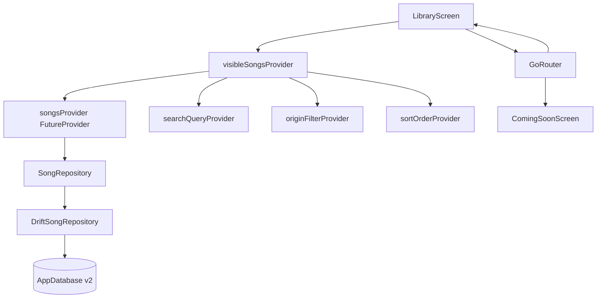

# Library Screen Design

**Spec**: `.specs/features/library-screen/spec.md`
**Status**: Approved

---

## Architecture Overview

Four layers get new code. Domain/data/infrastructure extend the existing `Song`/`SongRepository` vertical slice (additive, no breaking changes). Presentation adds the first screen, the first router, and the first set of shared widgets — all new ground, but following `COMPONENTS.md`'s naming and `flutter-clean-architecture`'s layer rules.



State flows one way: `songsProvider` loads once from the repository; `searchQueryProvider`/`originFilterProvider`/`sortOrderProvider` are plain UI-local `StateProvider`s; `visibleSongsProvider` is a pure `Provider` that recomputes the derived list whenever any of the four inputs change. No provider talks to `GoRouter` — navigation is a widget-level `context.goNamed(...)` call, kept out of providers per the routing skill's guard-pattern precedent (testable predicates, not provider-driven navigation).

---

## Code Reuse Analysis

### Existing Components to Leverage

| Component | Location | How to Use |
| --- | --- | --- |
| `Song`, `SongTrack`, `Naipe` | `lib/domain/entities/` | Extend `Song` with two new optional fields; `Naipe`/`SongTrack` unchanged |
| `SongRepository` | `lib/domain/repositories/song_repository.dart` | Add one method (`markRehearsed`); existing methods unchanged |
| `DriftSongRepository`, `SongMapper` | `lib/data/` | Extend mapper's two directions; add `markRehearsed` impl reusing the existing transaction/try-catch pattern from `save`/`delete` |
| `AppDatabase`, `SongsTable` | `lib/infrastructure/database/` | First real use of drift's `stepByStep` migration (AD-009 already chose this strategy; this is its first application — `schemaVersion` goes 1→2) |
| `AppTheme`, `CantaeColors`, `CantaeTypography`, `CantaeSpacing`/`CantaeRadii`, `VoicePartColors` | `lib/presentation/theme/` | Every new widget reads these — zero literal values, per `AGENTS.md` §3 |
| `Result<S, F>` / `Failure` subclasses | `lib/domain/core/` | `markRehearsed` returns `Result<Unit, Failure>` with `NotFoundFailure`, matching `getById`/`delete` |
| `NativeDatabase.memory()` test pattern (AD-010) | `test/data/repositories/drift_song_repository_test.dart` | New repository tests follow the same in-memory-FFI pattern, no mocking |

### Integration Points

| System | Integration Method |
| --- | --- |
| `SongsTable` (drift) | Two new nullable/defaulted columns added via `stepByStep(from1To2: ...)` — additive, existing rows unaffected |
| `main.dart` | Replaced: `ProviderScope` stays; `MaterialApp` becomes `MaterialApp.router` wired to the new `routerProvider`; `theme`/`darkTheme` become `AppTheme.light`/`AppTheme.dark` (first real consumer of the theme-tokens feature) |
| `go_router` (new dependency) | `pubspec.yaml` gains `go_router: ^18.1.4`. One `GoRouter` instance via `Provider<GoRouter>`, created once (per the flutter-routing skill's "never rebuild per navigation" rule) |

---

## Approach Exploration — State Layer

Two viable approaches were presented to the user:

1. **Small composed providers** (chosen) — `songsProvider` (`FutureProvider<List<Song>>`) + three plain `StateProvider`s (query/filter/sort) + one derived `Provider<AsyncValue<List<Song>>>` (`visibleSongsProvider`) that recomputes on any dependency change.
2. **Single `StateNotifier` controller** — one class owns raw list + params + derived list together.

**User confirmed approach 1.** Rationale: no new dependency (no `riverpod_generator`/code-gen needed, unlike a `@riverpod` class-based notifier), each piece (search match, origin filter, sort comparator) is a pure function testable via `ProviderContainer` without touching widgets, and it avoids a God-object controller that mixes loading/filtering/sorting responsibilities the spec already treats as separable ACs (LIB-05/06/07).

---

## Components

### `SongOrigin` (domain)

- **Purpose**: Distinguishes a locally-created song from one received from another device.
- **Location**: `lib/domain/entities/song_origin.dart`
- **Interfaces**: `enum SongOrigin { created, received }`
- **Dependencies**: none
- **Reuses**: mirrors `Naipe`'s existing one-enum-per-file convention

### `Song` (domain, extended)

- **Purpose**: Adds `origin` and `lastRehearsedAt` without breaking any existing constructor call.
- **Location**: `lib/domain/entities/song.dart`
- **Interfaces**: `Song({..., SongOrigin origin = SongOrigin.created, DateTime? lastRehearsedAt})`
- **Dependencies**: `SongOrigin`
- **Reuses**: existing `Song` class, existing `assert`-based validation style (no new asserts needed — both new fields are unconstrained)

### `SongRepository.markRehearsed` (domain, extended)

- **Purpose**: The one real mutator for `lastRehearsedAt`.
- **Location**: `lib/domain/repositories/song_repository.dart`
- **Interfaces**: `Future<Result<Unit, Failure>> markRehearsed(String id, DateTime at)`
- **Dependencies**: none (interface only)
- **Reuses**: `Result`/`Unit`/`Failure` from `lib/domain/core/`

### `DriftSongRepository.markRehearsed` (data, extended)

- **Purpose**: Updates only `lastRehearsedAt` for one row, leaving tracks/lyrics untouched.
- **Location**: `lib/data/repositories/drift_song_repository.dart`
- **Interfaces**: implements the above; internally: check row exists (reuse `delete`'s existence-check pattern) → `update` with a single-column `SongsTableCompanion`.
- **Dependencies**: `AppDatabase`
- **Reuses**: the existing not-found-check pattern from `delete`

### `SongMapper` (data, extended)

- **Purpose**: Maps the two new columns both directions.
- **Location**: `lib/data/mappers/song_mapper.dart`
- **Interfaces**: unchanged signatures; `toCompanion` writes `origin.name` + `lastRehearsedAt`; `fromRow` parses `SongOrigin.values.byName(row.origin)` (falls back to `SongOrigin.created` if a legacy pre-migration row somehow has a null/unknown value — defensive only, migration already backfills) and passes through `row.lastRehearsedAt`.
- **Dependencies**: `SongOrigin`
- **Reuses**: existing mapper structure

### `SongsTable` + migration (infrastructure, extended)

- **Purpose**: Persist the two new fields.
- **Location**: `lib/infrastructure/database/tables/songs_table.dart`, `lib/infrastructure/database/app_database.dart`
- **Interfaces**: `TextColumn get origin => text().withDefault(const Constant('created'))()`, `DateTimeColumn get lastRehearsedAt => dateTime().nullable()()`; `schemaVersion => 2`; `migration` gains `stepByStep(from1To2: (m, schema) async { await m.addColumn(schema.songsTable, schema.songsTable.origin); await m.addColumn(schema.songsTable, schema.songsTable.lastRehearsedAt); })`.
- **Dependencies**: drift's generated `Schema2` step (requires `drift_dev`'s schema export — see Tech Decisions)
- **Reuses**: AD-009's established additive-migration strategy; this is its first real application

### Riverpod providers (presentation, new)

- **Purpose**: Reactive glue between `SongRepository` and `LibraryScreen`.
- **Location**: `lib/presentation/providers/song_repository_provider.dart`, `lib/presentation/providers/library_providers.dart`
- **Interfaces**:
  - `songRepositoryProvider: Provider<SongRepository>` (constructs `DriftSongRepository` over an app-wide `AppDatabase` provider)
  - `songsProvider: FutureProvider<List<Song>>` → `ref.watch(songRepositoryProvider).getAll()`, unwraps `Result` into either the list or a thrown typed exception caught by `AsyncValue` (Riverpod's own `FutureProvider` error channel — the screen reads `.when(data:, loading:, error:)`)
  - `searchQueryProvider: StateProvider<String>` (default `''`)
  - `originFilterProvider: StateProvider<SongOrigin?>` (default `null` = "Todas")
  - `sortOrderProvider: StateProvider<LibrarySortOrder>` (default `LibrarySortOrder.name`)
  - `visibleSongsProvider: Provider<AsyncValue<List<Song>>>` — pure function composing the four above
  - `highlightedSongIdProvider: Provider<String?>` — pure function over `songsProvider`'s raw (unfiltered) list, independent of search/filter/sort per spec AC LIB-08
- **Dependencies**: `SongRepository`, `Song`, `SongOrigin`
- **Reuses**: nothing existing (first presentation-layer providers)

### `LibrarySortOrder` (presentation)

- **Purpose**: The two sort options the user confirmed.
- **Location**: `lib/presentation/providers/library_providers.dart` (co-located with the provider that uses it — single small enum, not worth its own file per `AGENTS.md` §4's "proposta inicial, ajuste aos padrões" latitude)
- **Interfaces**: `enum LibrarySortOrder { name, lastRehearsed }`

### Shared widgets (presentation, new — `lib/presentation/widgets/`)

| Widget | Purpose | Reuses |
| --- | --- | --- |
| `CantaeScaffold` | Top/body/footer shell every screen uses (`COMPONENTS.md`) | `CantaeSpacing`, `CantaeColors` |
| `NavPill` | Top nav pill (`back`/`action` variants used here: "Importar") | theme tokens |
| `SearchField` | Debounce-free text field (filtering is instant per spec) | theme tokens |
| `SegmentedControl` | Generic 2-3-option tab control (Todas/Criadas/Recebidas here; reused later for naipe pickers per `COMPONENTS.md`) | theme tokens |
| `VoicePartBadge` | Naipe badge, `filled`/`missing`/`visitor`/`all` variants (only `filled`/`missing` used here) | `VoicePartColors` |
| `SongRow` | One library list row | `VoicePartBadge`, `CantaeTypography` |
| `EmptyState` | Generic empty-state block (icon/title/message/actions) | theme tokens |
| `PrimaryButton`, `SecondaryButton` | Generic buttons (used in `EmptyState` and the screen footer) | theme tokens |

Each gets its own file (`snake_case`) and its own widget test per `COMPONENTS.md`'s closing convention — this is `flutter-ui-ux`/`AGENTS.md` territory, not a Library-screen-specific test.

### `LibraryScreen` (presentation)

- **Purpose**: Assembles the above into the actual screen, all 5 states from spec P1.
- **Location**: `lib/presentation/screens/library/library_screen.dart`
- **Interfaces**: `ConsumerWidget`, no constructor params (reads everything from providers; navigation via `context.goNamed(...)`)
- **Dependencies**: all providers above, all shared widgets above
- **Reuses**: everything in this design doc

### `ComingSoonScreen` (presentation)

- **Purpose**: Placeholder target for the 5 not-yet-built routes.
- **Location**: `lib/presentation/screens/coming_soon/coming_soon_screen.dart`
- **Interfaces**: `ComingSoonScreen({required String title})`
- **Dependencies**: `CantaeScaffold`, `EmptyState`, `NavPill`
- **Reuses**: the same shared widgets as `LibraryScreen`

### `AppRouter` (presentation)

- **Purpose**: The one `GoRouter` instance.
- **Location**: `lib/presentation/routing/app_router.dart`
- **Interfaces**: `routerProvider: Provider<GoRouter>`; named routes: `library` (`/`), `song-detail` (`/songs/:id`), `room-create` (`/room/create`), `room-join` (`/room/join`), `profile` (`/profile`), `package-import` (`/import`)
- **Dependencies**: `LibraryScreen`, `ComingSoonScreen`
- **Reuses**: the flutter-routing skill's named-route convention (`context.goNamed`, never raw path strings)

---

## Data Models

### `Song` (extended)

```dart
class Song {
  // ...existing fields unchanged...
  final SongOrigin origin;        // new, defaults to SongOrigin.created
  final DateTime? lastRehearsedAt; // new, defaults to null
}
```

**Relationships**: unchanged — still owns `tracks`/`lyrics`/`playbackTrack` by value, no new entity relationships.

### `SongsTable` (drift, schema v2)

```dart
class SongsTable extends Table {
  // ...existing columns unchanged...
  TextColumn get origin => text().withDefault(const Constant('created'))();
  DateTimeColumn get lastRehearsedAt => dateTime().nullable()();
}
```

---

## Error Handling Strategy

| Error Scenario | Handling | User Impact |
| --- | --- | --- |
| `songsProvider`'s `SongRepository.getAll()` returns `Failure` | `FutureProvider` surfaces it as `AsyncError`; `LibraryScreen` renders `InlineBanner(variant: error)` with a "Tentar de novo" action calling `ref.invalidate(songsProvider)` | Banner with retry, per spec LIB-11 |
| `markRehearsed` called with unknown id | `Result.failure(NotFoundFailure(...))`, same convention as `getById`/`delete` | N/A this feature (no caller yet) — future caller's concern |
| Migration runs on a pre-v1 fresh install | `onCreate` path (unchanged) creates the v2 schema directly — `stepByStep` only applies to an upgrade from an existing v1 database | No user-visible difference; covered by existing `onCreate` test precedent |
| Router hits an unknown path | `go_router`'s default `errorBuilder` — not customized in this feature (no spec AC requires it); default Flutter "page not found" is acceptable for an app with no external deep links yet | Flagged as a Risk below, not blocking |

---

## Risks & Concerns

| Concern | Location (file:line) | Impact | Mitigation |
| --- | --- | --- | --- |
| `go_router`'s default error page is unstyled (no `CantaeScaffold`/theme) | `lib/presentation/routing/app_router.dart` (new) | A mis-typed route name during later development would show a jarring default Material error screen | Acceptable for now — no spec AC requires a themed 404, and the only routes that exist are the ones this feature defines; flagged as a follow-up for whichever future feature adds deep linking (room codes aren't URLs, per the flutter-routing skill, so this risk stays low) |
| `drift_dev`'s schema-version export (`schema/` folder + `drift_dev schema dump`) has never been used in this project — `stepByStep` migrations are usually verified against an exported schema snapshot, not just written by hand | `lib/infrastructure/database/app_database.dart` (new migration) | A hand-written `stepByStep` step could silently diverge from what `drift_dev`'s codegen actually expects, or skip the recommended `schemaVersion` export/verification step drift's own docs describe | Mitigated by a dedicated migration test (T-level, in Tasks) that runs the v1→v2 step against a database seeded at v1 and asserts both the data survives and the new columns have the right defaults — same empirical approach AD-010 already uses instead of trusting drift's schema-export tooling blindly |
| First-ever `MaterialApp` → `MaterialApp.router` swap in `main.dart` | `lib/main.dart` | Could silently drop the Material 3 boilerplate theme already there (which is fine — it's unstyled placeholder, not a real requirement) or break app startup if `routerProvider` isn't read correctly | Mitigated by this being explicit Task scope (not a side-effect of another task) with its own gate check (`flutter test`/`flutter analyze` must still pass, plus a smoke widget test pumping `CantaeApp` and asserting the Biblioteca route renders) |
| `SongMapper.fromRow`'s defensive `SongOrigin.values.byName(...)` fallback (Data Models section) is unreachable in practice (migration always backfills `'created'`) | `lib/data/mappers/song_mapper.dart` (new code) | A literal "no test can ever hit this branch honestly" — would be dead code if written as a silent fallback | Mitigated by NOT adding a fallback at all: `fromRow` calls `SongOrigin.values.byName(row.origin)` directly (the column has a drift-enforced default, so `row.origin` is never null/invalid) — removed from the design; the "defensive fallback" idea above is rejected, not implemented, specifically to avoid untestable dead code, per `CLAUDE.md`'s complexity/no-speculative-code rules |

---

## Tech Decisions

| Decision | Choice | Rationale |
| --- | --- | --- |
| Router package | `go_router: ^18.1.4` | Current stable (pub.dev, verified via WebFetch this session), matches the project's own `flutter-routing` skill, which already documents this exact API shape |
| State management for derived list | Small composed `Provider`/`StateProvider`s, no code-gen | User-confirmed; avoids adding `riverpod_generator` for a single screen's state |
| `origin` column storage | `TextColumn` storing the enum's `.name` string (`'created'`/`'received'`), not an `IntColumn` index | Matches drift's own documented recommendation for enum columns (index-based storage breaks silently if enum order ever changes; name-based is self-describing in raw SQL inspection) |
| Migration verification | Hand-written `stepByStep` + a dedicated migration test seeding a v1 `NativeDatabase`, rather than adopting `drift_dev`'s schema-export/`verifySelf` tooling in this feature | Keeps this feature's scope to what's needed now; schema-export tooling adoption (if ever needed) is a separate infra decision, not forced by this feature — flagged, not deferred silently (see Risks) |
| `ComingSoonScreen` as a single shared widget vs. 5 separate stub screens | One shared widget, parameterized by `title` | 5 near-identical files would violate `COMPONENTS.md`'s reuse convention for no benefit; each real future feature replaces its own route's builder independently regardless |

> **Project-level decision**: adopting `go_router` is a convention every future screen will follow — appended to `.specs/STATE.md` `## Decisions` as AD-012.
