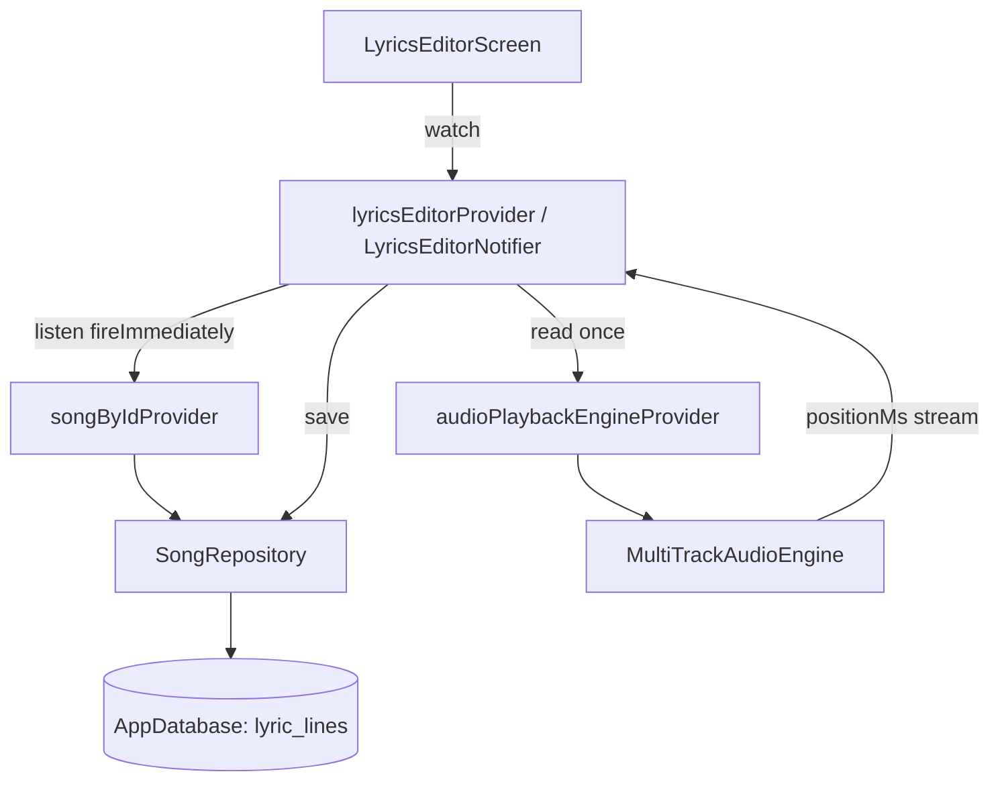

# Editor de letra (lyrics-editor) Design

**Spec**: `.specs/features/lyrics-editor/spec.md`
**Status**: Draft

---

## Architecture Overview

Single-screen feature, same shape as `track-align-screen`: one `StateNotifierProvider.autoDispose.family` keyed by `songId`, driving one `ConsumerWidget` screen with a status switch. Reuses the already-loaded `MultiTrackAudioEngine` (via `audioPlaybackEngineProvider`) purely for playback positioning during "Ouvir com a letra" — no new audio-engine capability is needed.

The one new piece of real complexity is at the domain/schema boundary: `LyricLine.onsetMs` goes from a required `int` to an optional `int?`, which is a breaking change to the existing table column and needs a real migration, not just an added column.



---

## Code Reuse Analysis

### Existing Components to Leverage

| Component | Location | How to Use |
| --------- | -------- | ---------- |
| `TrackAlignDuration.format`/`.parse` | `lib/presentation/widgets/track_align_row.dart:42-64` | Import directly for the `mm:ss.s` display/parse of `onsetMs` and of the footer's current-position clock. No duplicate formatter. |
| `TrackAlignNotifier` shape (status enum, `songByIdProvider` listener, `autoDispose.family`, `toggleTest`/`_stopTest`, `save()`) | `lib/presentation/providers/track_align_notifier.dart` | Structural template for `LyricsEditorNotifier` — same `_ref.listen(fireImmediately: true)` wiring, same "don't await `cancel()`" fix already learned the hard way on this exact stream. |
| `AudioPlaybackEngine`/`audioPlaybackEngineProvider` | `lib/domain/audio/audio_playback_engine.dart`, `lib/presentation/providers/audio_playback_engine_provider.dart` | `loadSong`, `playAt(DateTime.now())`, `stop()`, `seekAllTo(0)`, `positionMs` stream — identical usage to `track-align-screen`'s "Ouvir em loop", just without the `LoopController` (this screen never loops). |
| `ConfirmSheet`, `Toast`, `EmptyState`, `InlineBanner`, `NavPill`, `CantaeScaffold`, `PrimaryButton`/`SecondaryButton` | `lib/presentation/widgets/*.dart` | Used as-is, no changes. |
| `SegmentedControl<T>` | `lib/presentation/widgets/segmented_control.dart` | Generic — reused directly for the inline naipe picker (`SegmentedControl<Naipe?>`, 5 options: 4 naipes + `null` = "Nenhum"). No new selection widget needed. |
| `VoicePartBadge` | `lib/presentation/widgets/voice_part_badge.dart` | `filled` variant for a line's naipe selo; omitted entirely when `naipe == null` (no "missing" badge here — that variant means "song has no track for this naipe", a different concept). |
| `SongRepository.save`/`songByIdProvider`/`songsProvider` | `lib/domain/repositories/song_repository.dart`, `lib/presentation/providers/song_detail_providers.dart`, `library_providers.dart` | Same whole-`Song`-object save pattern as `track-align-screen`'s `save()`. |

### Integration Points

| System | Integration Method |
| ------ | ------------------- |
| `drift` schema (`lyric_lines` table) | `onsetMs` column becomes nullable via a real `ALTER TABLE`-equivalent migration (see Data Models) — the first migration step in this project that isn't a plain `addColumn`. |
| `DriftSongRepository` | Lyric row ordering changes from `[onsetMs asc, rowId asc]` to `[rowId asc]` only — manual/insertion order, independent of marking state (spec.md's "ordem manual" decision), using the column that's already there instead of adding a new one. |

---

## Approach Exploration (ordering + "not yet marked" storage)

Three ways to satisfy spec.md's "onsetMs opcional" + "ordem manual" decisions:

1. **Recommended — nullable `onsetMs`, order = existing `rowId` insertion order.** `LyricLine.onsetMs: int?`; `save()` already deletes-then-reinserts every lyric row in `song.lyrics` list order on every save (unchanged code at `drift_song_repository.dart:28-56`), so `rowId` (autoincrement) naturally mirrors the manual order for free. Query order-by drops `onsetMs` from the sort, keeps `rowId`. Zero new columns, zero new domain fields.
2. Add a new `orderIndex` field to `LyricLine` + table column, keep `onsetMs` as the sort key for a separate "sorted view". Rejected: duplicates information `rowId` already encodes given the delete-and-reinsert save pattern; adds a field with no behavioral payoff.
3. Keep unmarked lines entirely in notifier memory, only ever write marked lines to the DB. Rejected by the user's own answer ("onsetMs opcional", not "rascunho em memória") — would also mean losing typed-but-unmarked lines on app restart, violating spec.md Goal #3.

**Chosen: Option 1.**

---

## Components

### Domain: `LyricLine` (modified)

- **Purpose**: Represents one letra line; now distinguishes "not yet marked" from "marked at 0ms".
- **Location**: `lib/domain/entities/lyric_line.dart`
- **Change**: `final int? onsetMs;` (was `final int`). Constructor assert becomes `assert(onsetMs == null || onsetMs >= 0, 'LyricLine.onsetMs must be >= 0 when set')`.
- **Dependencies**: none (pure domain, unchanged purity).
- **Reuses**: existing `Naipe` nullable field, existing `dynamics` nullable field — both already optional, no change needed there.

### Infrastructure: `LyricLinesTable` + migration (modified)

- **Purpose**: Persist the now-optional `onsetMs`.
- **Location**: `lib/infrastructure/database/tables/lyric_lines_table.dart`, `lib/infrastructure/database/app_database.dart`
- **Change**: `IntColumn get onsetMs => integer().nullable()();`. `schemaVersion` 2 → 3. New `onUpgrade` step:
  ```dart
  if (from < 3) {
    await m.alterTable(TableMigration(lyricLinesTable));
  }
  ```
- **Why `alterTable`, not `addColumn`**: confirmed by reading `drift-2.35.4`'s `Migrator` source (`lib/src/runtime/query_builder/migration.dart:161-315`) — `addColumn` only adds new columns; it cannot loosen an existing `NOT NULL` constraint, and SQLite itself has no `ALTER COLUMN`. `Migrator.alterTable(TableMigration(table))` is drift's own documented 12-step "rebuild the table" helper: it recreates the table from the *current* Dart schema (where `onsetMs` is already nullable), copies every existing row across unchanged (no `columnTransformer` needed — existing values are all non-null ints, which are valid values for a nullable column), drops the old table, and renames. This is additive in effect (no data loss, no prior migration step edited) even though it isn't a single `addColumn` call — consistent with AD-009's intent, which this entry documents as the second corrected API detail (the first being the `stepByStep` → `Migrator.addColumn` correction already on record).
- **Dependencies**: `drift`'s `Migrator.alterTable`/`TableMigration` (already a transitive dependency, no new package).
- **Reuses**: the existing `onUpgrade` callback shape at `app_database.dart:26-31`.

### Data: `LyricLineMapper` (modified)

- **Purpose**: Map the now-nullable field both ways.
- **Location**: `lib/data/mappers/lyric_line_mapper.dart`
- **Change**: `toCompanion` passes `onsetMs: Value(line.onsetMs)` instead of a bare positional value (drift companions need `Value(null)` to write an explicit `NULL`, vs. omitting the field entirely which would mean "leave unchanged" on an update — irrelevant here since every lyric row is a fresh `.insert()`, but `Value(...)` is still correct/required once the column itself is nullable). `fromRow` passes `onsetMs: row.onsetMs` directly (already `int?` once the table column is nullable — no cast needed).
- **Dependencies**: `LyricLine`, generated `LyricLinesTableData`/`LyricLinesTableCompanion`.

### Data: `DriftSongRepository` (modified)

- **Purpose**: Order lyric rows by insertion order, not by a now-partially-null `onsetMs`.
- **Location**: `lib/data/repositories/drift_song_repository.dart:78-83` and `:113-119`
- **Change**: `orderBy([(l) => OrderingTerm.asc(l.rowId)])` (drop the `onsetMs` term from both `getById` and `getAll`'s lyric queries). `save()` is unchanged — it already inserts `song.lyrics` in list order inside a transaction that deletes all prior rows first, which is exactly what makes `rowId` ascending equal to manual order after every save.
- **Dependencies**: unchanged.

### Presentation: `LyricsEditorState` / `LyricsEditorNotifier` (new)

- **Purpose**: Owns the working copy of `song.lyrics`, the preview/marking playback flow, and save.
- **Location**: `lib/presentation/providers/lyrics_editor_notifier.dart`
- **Interfaces**:
  - `enum LyricsEditorStatus { loading, notFound, error, loaded }` — no `noTracks` status; an empty-tracks song is still `loaded` (spec.md P3: a banner, never a block).
  - `class LyricsEditorState` — fields: `status`, `song`, `lines` (`List<LyricLine>`, the working copy), `expandedIndex` (`int?`, which line is inline-expanded — ephemeral UI state, never sets `hasUnsavedChanges`), `previewing` (`bool`), `currentPositionMs` (`int`, last value from the engine's `positionMs` stream while previewing), `markError` (`String?`), `previewError` (`String?`), `hasUnsavedChanges` (`bool`), `saving` (`bool`), `saveError` (`String?`).
    - Computed getters (not stored, mirroring how `TrackAlignNotifier.toggleTest` derives a `LoopController` on demand rather than caching it):
      - `int get markedCount => lines.where((l) => l.onsetMs != null).length;`
      - `int? get nextUnmarkedIndex` — first index with `onsetMs == null`, or `null`.
      - `int? get currentLineIndex` — index of the marked line with the greatest `onsetMs <= currentPositionMs`, or `null` if none qualify (spec.md AC-LYR-13 / "linha atual").
  - `addLine()` — appends an empty `LyricLine(text: '', onsetMs: null)`, sets `expandedIndex` to its new index, `hasUnsavedChanges = true`.
  - `updateText(int index, String text)` — rejects (no-op) if `text.isEmpty || text.length > 200`; else replaces the line, `hasUnsavedChanges = true`.
  - `updateNaipe(int index, Naipe? naipe)` — replaces the line's naipe, `hasUnsavedChanges = true`.
  - `updateDynamics(int index, String? dynamics)` — rejects if `dynamics != null && dynamics.length > 40`; else replaces, `hasUnsavedChanges = true`.
  - `setExpanded(int? index)` — pure UI toggle, no `hasUnsavedChanges`.
  - `togglePreview()` — if `previewing`, calls `_stopPreview()`; else, no-ops when `state.song!.tracks.isEmpty` (spec.md P3 AC2), otherwise loads the engine on first use (`await _engine.loadSong(song)` inside a try/catch → `previewError` on failure, mirroring `TrackAlignNotifier._onSongLoaded`'s own try/catch), seeks to `0`, `playAt(DateTime.now())`, subscribes `positionMs` into `currentPositionMs`, sets `previewing = true`, clears `markError`.
  - `_stopPreview()` — cancels the subscription **without awaiting** (same fix already made in `TrackAlignNotifier._stopTest`, same never-resolves-under-FakeAsync reason), `await _engine.stop()`, `previewing = false`.
  - `markNow()` — reads `nextUnmarkedIndex`; no-ops if `null` (AC-LYR-07/spec P1 AC8). Finds the nearest preceding marked line's `onsetMs` (searching backwards from `nextUnmarkedIndex - 1`); if `currentPositionMs < thatOnset`, sets `markError` and returns (AC-LYR-06/spec P1 AC7) without mutating `lines`. Otherwise replaces that line with `onsetMs: currentPositionMs`, clears `markError`, `hasUnsavedChanges = true`.
  - `save()` — same shape as `TrackAlignNotifier.save()`: builds an updated `Song` with `lyrics: state.lines`, calls `SongRepository.save`, on success invalidates `songsProvider` **and** re-fetches via `_ref.invalidate(songByIdProvider(_songId))` (needed here, unlike track-align, because the DB round-trip is what re-establishes `rowId` order for any lines added this session), clears `hasUnsavedChanges`; on failure sets `saveError`, state and `lines` are preserved either way (spec.md Edge Cases).
  - `retry()` — same pattern as `TrackAlignNotifier.retry()`.
  - `dispose()` — cancels the position subscription, calls `_engine.stop()`.
- **Dependencies**: `audioPlaybackEngineProvider`, `songByIdProvider`, `songRepositoryProvider`, `songsProvider`.
- **Reuses**: `TrackAlignNotifier`'s exact lifecycle/listener wiring; no new Riverpod pattern introduced.

Provider: `lyricsEditorProvider = StateNotifierProvider.autoDispose.family<LyricsEditorNotifier, LyricsEditorState, String>((ref, songId) => LyricsEditorNotifier(ref, songId));` — `autoDispose` for the same reason as `track-align-screen`: `dispose()`'s `engine.stop()` must fire on unmount so a preview left running doesn't keep playing in the background (spec.md Edge Cases).

### Presentation: `LyricLineRow` (new shared widget)

- **Purpose**: One letra line, collapsed (tempo, texto, selo+dinâmica, "Editar") or expanded (texto field, naipe `SegmentedControl<Naipe?>`, dinâmica field) — the inline-expand pattern the user picked, same spirit as `TrackAlignRow`'s always-inline offset field.
- **Location**: `lib/presentation/widgets/lyric_line_row.dart`
- **Interfaces**:
  - Constructor: `LyricLineRow({required LyricLine line, required bool isCurrent, required bool expanded, required VoidCallback onToggleExpanded, required ValueChanged<String> onTextChanged, required ValueChanged<Naipe?> onNaipeChanged, required ValueChanged<String?> onDynamicsChanged})`.
- **Dependencies**: `TrackAlignDuration.format` (time display), `VoicePartBadge`, `SegmentedControl<Naipe?>`.
- **Reuses**: `TrackAlignRow`'s blur-revert `TextEditingController`/`FocusNode` pattern for the texto and dinâmica fields (revert to last-valid value on blur instead of a modal validation error — same UX already shipped and tested).
- **Doc update required**: add this component to `docs/design/COMPONENTS.md` under "Reprodução e letra" (AGENTS.md §6 — new shared component must land in the same PR).

### Presentation: `LyricsEditorScreen` (new)

- **Purpose**: All 4 statuses (`loading`/`notFound`/`error`/`loaded`) in one file, same precedent as `TrackAlignScreen`.
- **Location**: `lib/presentation/screens/lyrics_editor/lyrics_editor_screen.dart`
- **Structure** (loaded state): `NavPill.back` (title = song name, `ConfirmSheet` on unsaved changes, same `_handleBack` shape as `track-align-screen`) + `NavPill.action` "Ouvir com a letra" top-right, visible only when `!previewing`; title "Letra" + "`markedCount` de `lines.length` marcadas"; `InlineBanner.warning` when `song.tracks.isEmpty` (P3, with an action linking to `track-align`); scrollable list of `LyricLineRow`s (highlighting `currentLineIndex`) + a trailing "+ Acrescentar linha" action; footer is `null` unless `previewing`, in which case it shows the "Próxima: `<texto>` `<mm:ss.s>`" card + `[S] Pausar` + `[P] Marcar agora]` (disabled when `nextUnmarkedIndex == null`) + `[P] Salvar` is the persistent primary action regardless of preview state (spec.md P1 AC12 has no preview precondition).
- **Dependencies**: `lyricsEditorProvider`, same widget set as `TrackAlignScreen`.
- **Reuses**: `TrackAlignScreen`'s `_StateScaffold`/`_LoadingBody`/`_NotFoundBody`/`_ErrorBody` shapes verbatim (only `_NoTracksBody` has no equivalent here, since there's no hard-blocking status).

### Routing (modified)

- **Location**: `lib/presentation/routing/app_router.dart`
- **Change**: `lyrics-editor` route gains a `:id` path segment, same shape as `track-align`'s `:id` addition: `path: '/lyrics-editor/:id'`, `builder: (context, state) => LyricsEditorScreen(songId: state.pathParameters['id']!)`.
- **Also**: `lib/presentation/screens/song_detail/song_detail_screen.dart`'s existing `"Sincronizar letra · ..."` row (`:270-273`) passes `pathParameters: {'id': song.id}` to `context.goNamed('lyrics-editor', ...)`, same call shape as the "Alinhar entradas" row right above it.

---

## Data Models

### `LyricLine` (domain, modified)

```dart
class LyricLine {
  final String text;
  final int? onsetMs; // was: final int onsetMs
  final Naipe? naipe;
  final String? dynamics;
}
```

**Relationships**: `Song.lyrics: List<LyricLine>` — unchanged container; order of this list is now load-bearing (spec.md "ordem manual") rather than incidental.

### `lyric_lines` table (infrastructure, modified)

```
rowId        INTEGER PRIMARY KEY AUTOINCREMENT   -- already the manual-order key
song_id      TEXT NOT NULL REFERENCES songs(id) ON DELETE CASCADE
text         TEXT NOT NULL
onset_ms     INTEGER NULL                        -- was NOT NULL
naipe        TEXT NULL
dynamics     TEXT NULL
```

---

## Error Handling Strategy

| Error Scenario | Handling | User Impact |
| --------------- | -------- | ------------ |
| Song fetch fails (not a 404) | `status = error` | `InlineBanner` + "Tentar de novo" (identical to `track-align-screen`). |
| Song not found | `status = notFound` | `EmptyState` "Música não encontrada" + voltar à Biblioteca. |
| `_engine.loadSong(song)` throws on first "Ouvir com a letra" tap | `previewError` set, `previewing` stays `false` | Inline error near the top action; editing text/naipe/dinâmica remains fully usable. |
| Mark rejected (time before the previous marked line) | `markError` set, no mutation | Inline error near "Marcar agora"; cleared on the next successful mark or the next preview start. |
| Save fails | `saveError` set, `lines`/`hasUnsavedChanges` untouched | `InlineBanner.error`; the author's edits are never lost on a failed save. |
| Text/dinâmica edit out of bounds (empty text, >200/>40 chars) | Notifier method no-ops | Row's own field reverts to last-valid value on blur (same UX as `TrackAlignRow`'s offset field) — no modal, no toast. |

---

## Risks & Concerns

| Concern | Location (file:line) | Impact | Mitigation |
| ------- | --------------------- | ------ | ---------- |
| Breaking schema change (first non-`addColumn` migration in the project) | `lib/infrastructure/database/app_database.dart:13` (`schemaVersion`) | If `alterTable`'s rebuild-and-copy has any edge case under this project's actual installed drift version/SQLite build, a bad migration on a real device could lose lyric data. | Task-level: a migration test using `NativeDatabase.memory()` that opens a v2 database pre-populated with non-null `onset_ms` rows, runs the upgrade to v3, and asserts the rows and their `onset_ms` values survive unchanged (same `AD-010` in-memory-migration testing precedent already used for repository tests). |
| `markNow()`'s backward-scan for "the previous marked line" is O(n) per tap | `lyrics_editor_notifier.dart` (new) | Negligible — a letra has at most a few hundred lines, called once per manual tap, not per frame. | No mitigation needed; flagging only per design.md's concern-flagging requirement. |
| `currentLineIndex` recomputes by scanning all lines on every `positionMs` tick while previewing | `lyrics_editor_notifier.dart` (new) | Same bound as above (list is small, UI-thread scan, not per-sample audio processing) — not the kind of "heavy operation" AGENTS.md's off-UI-thread rule targets. | No mitigation needed. |

---

## Tech Decisions (only non-obvious ones)

| Decision | Choice | Rationale |
| -------- | ------ | --------- |
| How to make `onsetMs` nullable in SQLite | `Migrator.alterTable(TableMigration(lyricLinesTable))`, no `columnTransformer` | Confirmed by reading drift 2.35.4's source — this is drift's own rebuild-and-copy primitive for constraint/type changes `addColumn` can't express; existing non-null values are valid once copied into a nullable column, so no transform is needed. |
| Manual line order storage | Reuse the existing `rowId` autoincrement column; drop `onsetMs` from the `ORDER BY` | `save()` already deletes-and-reinserts every lyric row in list order on every save — `rowId` ascending already equals "manual order" with zero new fields. |
| Naipe picker options | 4 standard naipes + "Nenhum" (`null`) — no "Todos" | `Naipe` (domain enum) has no "coro todo" value; `Naipe.custom` means something else (reusable custom naipe, per AGENTS.md). Spec.md's assumption table is corrected accordingly in this design pass. |
| "Ouvir com a letra" always restarts at `0 ms` | No resume-from-pause | Matches `track-align-screen`'s already-shipped "Ouvir em loop" behavior (always restarts at `loopStartMs`) — same simplification, same precedent, avoids a third playback state. |
| Inline-expand is single-line (accordion) | `expandedIndex: int?`, not a `Set<int>` | Spec.md doesn't call for multiple simultaneous expansions; a single optional index is the smaller state shape and matches how the UI_SPEC describes "Editar" as a per-row toggle, not a bulk-edit mode. |

---

