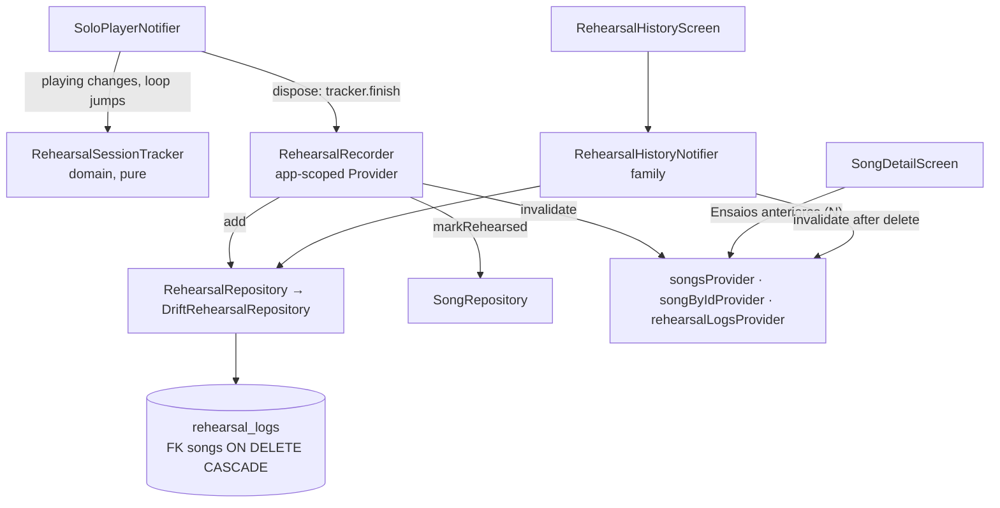

# Ensaios anteriores Design

**Spec**: `.specs/features/rehearsal-history/spec.md`
**Status**: Approved

---

## Architecture Overview

A pure domain tracker measures a Modo solo session. When the screen closes, the notifier hands the finished log to an **app-scoped recorder**, which saves it, marks the song as rehearsed and refreshes the providers that show it. A new screen reads the logs through a family notifier.



### Approaches considered

| Approach | Verdict |
| -------- | ------- |
| **A. Tracker in the domain + app-scoped recorder** (above) | **Chosen.** The session rules (playing time only, loop jumps, 60 s minimum) are pure and unit-testable. The recorder outlives the screen, so it can still save and invalidate after `SoloPlayerNotifier.dispose`, where the notifier's own `ref` can no longer be used. |
| B. Save from `SoloPlayerNotifier.dispose` directly through its `ref` | Rejected. Riverpod forbids `ref.read`/`invalidate` during dispose, so the Library sort and the detail count would never refresh. |
| C. Save on every pause | Rejected. It would split one session into several rehearsals and contradict "one rehearsal per session". |

---

## Code Reuse Analysis

### Existing Components to Leverage

| Component | Location | How to Use |
| --------- | -------- | ---------- |
| `SongRepository.markRehearsed` | `lib/data/repositories/drift_song_repository.dart:175` | Called by the recorder (HIST-05); already drives the "Último ensaio" sort |
| Drift FK cascade pattern | `lib/infrastructure/database/tables/song_tracks_table.dart` | `rehearsal_logs.song_id` references `songs` with `onDelete: cascade` (HIST-18); `PRAGMA foreign_keys = ON` already set |
| Additive migration | `lib/infrastructure/database/app_database.dart:26-37` | `if (from < 4) await m.createTable(rehearsalLogsTable)` |
| Migration test pattern | `test/infrastructure/database/app_database_migration_test.dart` | v3 → v4 upgrade keeps data and creates the table |
| `songByIdProvider`, `songsProvider` | `lib/presentation/providers/song_detail_providers.dart`, `library_providers.dart` | Song name on the history screen; invalidated after recording or deleting |
| `ConfirmSheet.show` | `lib/presentation/widgets/confirm_sheet.dart:17` | Both delete confirmations (HIST-14/15) |
| `EmptyState` | `lib/presentation/widgets/empty_state.dart` | "Nenhum ensaio registrado ainda" + "Ensaiar agora" (HIST-12) |
| `CantaeScaffold`, `NavPill`, `InlineBanner`, `Toast`, `TonalButton`, `SecondaryButton` | `lib/presentation/widgets/` | Screen chrome, error banner, "Ensaios apagados" toast, footer buttons |
| `SoloPlayerNotifier` state transitions | `lib/presentation/providers/solo_player_notifier.dart` | A `state` setter override feeds `playing` changes to the tracker, so every path (button, lock screen, end, interruption) counts the same; the loop-jump branch of `_onPosition` reports loops |

### Integration Points

| System | Integration Method |
| ------ | ------------------ |
| drift | New `RehearsalLogsTable`; `schemaVersion` 3 → 4 |
| go_router | `/song-history` becomes `/song-history/:id` (named `song-history`), building `RehearsalHistoryScreen` |
| Song detail | "Ensaios anteriores" row shows `(N)` from `rehearsalLogsProvider(songId)` and passes the id |

---

## Components

### `RehearsalLog` (domain entity)

- **Location**: `lib/domain/entities/rehearsal_log.dart`
- **Fields** (PRD `RehearsalLog`): `id` (UUID), `songId`, `startedAt`, `endedAt`, `durationMs`, `mode` (`RehearsalMode.solo | room`), `localRole` (`RehearsalRole? master | singer | visitor`, null in solo), `maxParticipants`, `loopCount`.
- Nothing else: no audio, lyrics or other people's data (HIST-06).

### `RehearsalRepository` (domain interface)

- **Location**: `lib/domain/repositories/rehearsal_repository.dart`
- **Interfaces**:
  - `add(RehearsalLog)` → `Result<Unit, StorageFailure>`
  - `getBySong(String songId)` → `Result<List<RehearsalLog>, StorageFailure>`, newest first
  - `deleteBySong(String songId)` → `Result<Unit, StorageFailure>`
  - `deleteAll()` → `Result<Unit, StorageFailure>`

### `RehearsalSessionTracker` (domain, pure)

- **Location**: `lib/domain/rehearsal/rehearsal_session_tracker.dart`
- **Interfaces**:
  - `void setPlaying(bool playing, DateTime now)` — opens or closes a playing span; repeated values are ignored; the first `true` sets `startedAt`.
  - `void loopJumped()` — counted only while playing.
  - `RehearsalLog? finish({required String id, required String songId, required DateTime now})` — closes an open span, returns null when never played or `durationMs < minDuration` (60 s).
- `static const minDuration = Duration(seconds: 60)`.

### `DriftRehearsalRepository` + `RehearsalLogsTable` + mapper (data / infrastructure)

- **Location**: `lib/infrastructure/database/tables/rehearsal_logs_table.dart`, `lib/data/mappers/rehearsal_log_mapper.dart`, `lib/data/repositories/drift_rehearsal_repository.dart`
- **Table** `rehearsal_logs`: `id` text PK; `song_id` text FK → songs cascade; `started_at`, `ended_at` datetime; `duration_ms`, `max_participants`, `loop_count` int; `mode` text; `local_role` text nullable. Index on `song_id`.
- **Errors**: every exception → `StorageFailure` (AD-002).

### `uuidV4()` (data)

- **Location**: `lib/data/ids/uuid_v4.dart`. RFC 4122 v4 from `Random.secure()`; no new dependency.

### Providers (presentation)

- **Location**: `lib/presentation/providers/rehearsal_providers.dart`
- `rehearsalRepositoryProvider` (drift, over `appDatabaseProvider`).
- `clockProvider = Provider<DateTime Function()>((_) => DateTime.now)`: tests override it.
- `rehearsalLogsProvider = FutureProvider.autoDispose.family<Result<List<RehearsalLog>, StorageFailure>, String>`.
- `rehearsalRecorderProvider` → `RehearsalRecorder.record(RehearsalLog)`:
  - adds the log, then calls `markRehearsed(songId, endedAt)`;
  - invalidates `songsProvider`, `songByIdProvider(songId)` and `rehearsalLogsProvider(songId)`;
  - never throws; a failure is swallowed (HIST-07).

### `SoloPlayerNotifier` changes

- Reads `rehearsalRecorderProvider` and `clockProvider` in the constructor, so they are still usable in `dispose`.
- Overrides the `state` setter: after `super.state = value`, it calls `_tracker.setPlaying(value.playing, _now())`.
- The loop-jump branch of `_onPosition` calls `_tracker.loopJumped()`.
- In `dispose`: `final log = _tracker.finish(id: uuidV4(), songId: _songId, now: _now())`, and if it is not null, `unawaited(_recorder.record(log))`.

### `RehearsalHistoryNotifier` (presentation)

- **Location**: `lib/presentation/providers/rehearsal_history_notifier.dart`
- `StateNotifierProvider.autoDispose.family` by song id.
- **State**: `status` (`loading | notFound | error | ready`), `songName`, `logs`, `deleting`, `deleteError`.
- **Derived**: `count`, `totalDurationMs`, `totalLoops`.
- **Methods**:
  - `retry()`;
  - `deleteForSong()` → `bool`;
  - `deleteAll()` → `bool`.
  - A successful delete empties the logs and invalidates `rehearsalLogsProvider` for this song (the detail count). `deleteAll` also invalidates the provider family as a whole.

### `StatTile` (shared widget, COMPONENTS.md)

- **Location**: `lib/presentation/widgets/stat_tile.dart`
- A large Geist Mono number (size 26 token) with a caption. Semantics read as "caption: value" in one node. Works in both themes and at 130% font.

### `RehearsalHistoryScreen`

- **Location**: `lib/presentation/screens/history/rehearsal_history_screen.dart`
- **Layout (UI_SPEC §6.16)**:
  - Top: `NavPill` back with the song name.
  - Title "Ensaios" and the line "Registrados só neste aparelho.".
  - A row of 3 `StatTile`s: "ensaios", "tempo", "loops".
  - A lazy list of rows "25 nov 2026 · 19:40" / "Modo solo" / duration (mono) / "8 loops".
  - Footer: [D tonal] "Apagar desta música" and [S] "Apagar tudo".
- **States**: loading, error ("Tentar de novo"), notFound ("Voltar à Biblioteca"), empty (`EmptyState` with "Ensaiar agora" → `solo-player`), ready.
- **Delete flow**:
  - On success: toast "Ensaios apagados".
  - On failure: an error `InlineBanner` with "Não foi possível apagar os ensaios.".

### Formatting (presentation)

- **Location**: `lib/presentation/formatting/rehearsal_format.dart`
- `formatDuration(int ms)`: `m:ss` below 1 hour, `h:mm:ss` from 1 hour.
- `formatRehearsalDate(DateTime)`: "25 nov 2026 · 19:40", with pt-BR month abbreviations.

---

## Data Models

```dart
enum RehearsalMode { solo, room }
enum RehearsalRole { master, singer, visitor }

class RehearsalLog {
  final String id;
  final String songId;
  final DateTime startedAt;
  final DateTime endedAt;
  final int durationMs;
  final RehearsalMode mode;
  final RehearsalRole? localRole;   // null in solo
  final int maxParticipants;        // 1 in solo
  final int loopCount;
}
```

**Relationships**: many logs per song; deleting a song cascades.

---

## Error Handling Strategy

| Error Scenario | Handling | User Impact |
| -------------- | -------- | ----------- |
| Save fails after leaving Modo solo | `RehearsalRecorder` swallows the `StorageFailure` | The rehearsal is lost silently (spec assumption); leaving is never blocked |
| `markRehearsed` fails after the log saved | Swallowed | The log shows; the Library sort keeps the old date |
| Reading logs fails | `status: error` | "Não foi possível carregar os ensaios." + "Tentar de novo" |
| Song not found | `status: notFound` | "Música não encontrada" + "Voltar à Biblioteca" |
| Delete fails | `deleteError`; logs kept | Banner "Não foi possível apagar os ensaios." |

---

## Risks & Concerns

| Concern | Location (file:line) | Impact | Mitigation |
| ------- | -------------------- | ------ | ---------- |
| `SoloPlayerNotifier` is already large (mix, loop, metronome, remote, interruptions) | `lib/presentation/providers/solo_player_notifier.dart` | More coupling | Session rules live in the pure `RehearsalSessionTracker`; the notifier only forwards two signals. The `state` setter override keeps every playing path consistent without touching each one |
| Recording in `dispose` relies on objects read in the constructor | same | Reading after dispose would throw | The recorder and clock are captured in the constructor; a test disposes the container and checks the save |
| The app killed by the OS before leaving Modo solo loses that rehearsal | — | Possible loss in background use | Accepted in the spec; recorded as debt |
| Schema migration v3 → v4 | `app_database.dart` | A bad migration loses the library | `createTable` only (additive); a migration test upgrades a v3 file with a song and checks it survives |

---

## Tech Decisions (only non-obvious ones)

| Decision | Choice | Rationale |
| -------- | ------ | --------- |
| Where session rules live | Domain `RehearsalSessionTracker` | Pure, failure-first unit tests (AD-005) |
| Feeding `playing` | Override `SoloPlayerNotifier.state` setter | One hook covers the button, lock screen, end, interruptions and the metronome's internal pause/resume (which never flips `state.playing`) |
| IDs | Hand-rolled UUID v4 with `Random.secure` | The PRD asks for UUIDs; no `uuid` dependency in the project (AD-004 spirit: avoid late deps for a few lines) |
| Dates without `intl` | Fixed pt-BR month table | No l10n package exists yet (known debt) |
