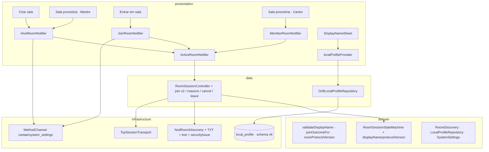

# Criar sala + Entrar em sala Design

**Spec**: `.specs/features/room-entry/spec.md`
**Context**: `.specs/features/room-entry/context.md` (D1–D6)
**Status**: Draft

---

## Architecture Overview

Abordagem A (context.md D5): estender o `RoomSessionController` da Fase 3 e o protocolo de entrada, sem trocar a peça que playback e transferência já usam. Um único `ActiveRoomNotifier`, vivo enquanto o app vive, guarda a sala ativa do aparelho (ROOM-47). As telas leem estado de notifiers de tela, que traduzem o `RoomSessionSnapshot` e os resultados do controller em modelos de visão; nenhuma tela vê `sessionKey`, conexão ou código de falha.



### Fluxo de entrada (protocolo estendido)

```mermaid
sequenceDiagram
    participant C as Cantor (JoinRoomNotifier)
    participant RC as RoomSessionController (Cantor)
    participant M as RoomSessionController (Mestre)
    participant H as HostRoomNotifier
    C->>RC: requestJoin(room, code, displayName)
    RC->>M: JoinRequest v2 {deviceId, code, protocolVersion, displayName}
    alt versão ≠ / código errado / sala cheia
      M-->>RC: JoinRejected {protocol-mismatch | invalid-code | room-full}
    else válido
      M->>H: snapshot: pending(displayName)
      alt Aprovar
        H->>M: approve(id)
        M->>RC: HandshakeInit → HandshakeResponse
        RC-->>C: success → sala provisória do Cantor
      else Recusar
        H->>M: reject(id)
        M-->>RC: JoinRejected {rejected}, fecha
      else 60 s sem resposta
        M-->>RC: JoinRejected {request-expired}, fecha
      end
    end
    Note over RC: conexão fecha antes da resposta → connection-lost<br/>cancelJoin() → fecha a conexão; Mestre vê o pedido sumir
```

---

## Code Reuse Analysis

### Existing Components to Leverage

| Component | Location | How to Use |
| --- | --- | --- |
| `RoomSessionController` | `lib/data/session/room_session_controller.dart` | Estender: join v2, recusa com motivo, expiração avisada, `cancelJoin`, `leaveRoom`, `masterConnectionLost`, `updateAnnouncement` |
| `RoomSessionStateMachine` | `lib/domain/session/room_session_state_machine.dart` | Estender `requestJoin` com `displayName` e `protocolVersion`; regras de 8 vagas, 60 s e handshake ficam como estão |
| `ParticipantSession` | `lib/domain/session/participant_session.dart` | Campo aditivo `displayName` |
| `JoinRequestMessage` / `JoinRejectedMessage` | `lib/data/session/session_wire_message.dart` | Anexar `protocolVersion` (u16) e `displayName` ao fim do pedido; decodificação sem esses campos = versão 0 |
| `NsdRoomDiscovery` | `lib/infrastructure/network/nsd_room_discovery.dart` | TXT `c`/`m`/`s`/`v`, evento `lost`, `NsdError(securityIssue)` → falha de permissão |
| `TcpSessionTransport`, `HandshakeService`, `EnvelopeAuthenticator` | `lib/infrastructure/network/`, `lib/domain/session/` | Sem mudança |
| `InlineBanner`, `StatusPill`, `Toast`, `ConfirmSheet`, `PrimaryButton`/botões, `CantaeScaffold`, `SectionLabel`-like rows | `lib/presentation/widgets/` | Estados, avisos e confirmações das telas |
| `songsProvider` | `lib/presentation/providers/library_providers.dart` | Lista de músicas na folha "Escolher música" |
| `validateSongFields` pattern | `lib/domain/library/song_rules.dart` | Mesmo formato de regra para `validateDisplayName` |
| Fakes de descoberta em barramento | `test/data/session/room_session_controller_test.dart:15` | Base do `InMemoryRoomDiscovery` dos testes ponta a ponta |
| Padrão de migração aditiva | `lib/infrastructure/database/app_database.dart` (`from < 5`) | Passo `from < 6` cria `local_profile` |

### Integration Points

| System | Integration Method |
| --- | --- |
| Rotas | `room-create` (`/room/create?songId=`), `room-join` (`/room/join`) deixam de usar `ComingSoonScreen`; novas `room-host` (`/room/host`) e `room-member` (`/room/member`). Detalhe passa `songId` |
| Banco | Schema v6: tabela `local_profile` (uma linha) |
| Playback/transferência | Continuam recebendo o mesmo `RoomSessionController`; a próxima feature lê o controller do `ActiveRoomNotifier` |
| Android | `AndroidManifest.xml` principal: `INTERNET`, `ACCESS_NETWORK_STATE`, `ACCESS_WIFI_STATE`, `CHANGE_WIFI_MULTICAST_STATE`; `MainActivity` com o canal de ajustes |
| iOS | `Info.plist`: `NSLocalNetworkUsageDescription` (pt-BR), `NSBonjourServices` = `_cantae._tcp`; `AppDelegate` com o canal de ajustes |

---

## Components

### Regras de domínio

- **Purpose**: Regras puras de nome, versão e tradução de falha em resultado de entrada.
- **Location**: `lib/domain/session/room_entry_rules.dart`
- **Interfaces**:
  - `const roomProtocolVersion = 1`
  - `const displayNameMaxLength = 40`
  - `Result<String, ValidationFailure> validateDisplayName(String raw)` → nome sem espaços nas pontas; `display_name_empty`, `display_name_too_long`
  - `String sanitizeRemoteDisplayName(String raw)` → tira caracteres de controle, corta em 40, vazio vira `"Sem nome"` (nome vindo da rede é dado não confiável)
  - `enum JoinOutcome { joined, rejected, roomFull, protocolMismatch, expired, connectionLost, invalidCode, cancelled }`
  - `JoinOutcome joinOutcomeFor(Failure f)` → mapeia `session.rejected`, `session.room-full`, `session.protocol-mismatch`, `session.request-expired`, `session.invalid-code`, `session.join-cancelled`; qualquer outro código → `connectionLost`
- **Dependencies**: `Result`, `Failure`
- **Reuses**: formato de `song_rules.dart`

### `RoomSessionStateMachine` (estendida)

- **Purpose**: Guardar nome e versão no pedido, recusar versão diferente antes de tudo.
- **Location**: `lib/domain/session/room_session_state_machine.dart`
- **Interfaces**:
  - `requestJoin(DeviceId id, String code, DateTime now, {String displayName = '', int protocolVersion = roomProtocolVersion})` — `session.protocol-mismatch` quando a versão difere (checado antes do código)
  - `ParticipantSession.displayName` preenchido a partir do pedido
- **Reuses**: limites e TTLs existentes

### `RoomDiscovery` (porta estendida) e `NsdRoomDiscovery`

- **Purpose**: Anunciar código, Mestre, música e versão; avisar quando uma sala some; distinguir permissão negada.
- **Location**: `lib/domain/session/room_discovery.dart`, `lib/infrastructure/network/nsd_room_discovery.dart`
- **Interfaces**:
  - `class RoomAnnouncement { code, masterName, songName?, protocolVersion }`
  - `Future<Result<Unit, NetworkFailure>> advertise(RoomId id, int port, RoomAnnouncement announcement)` — `discovery.permission-denied` (`ErrorCause.securityIssue`) ou `discovery.failed`
  - `Future<void> stopAdvertising()`
  - `Stream<DiscoveredRoom> discover()` — `DiscoveredRoom` ganha `code`, `masterName`, `songName`, `available` (`false` = sala sumiu); erro do stream é um `NetworkFailure` com os mesmos códigos
  - TXT: `c` = código, `m` = nome do Mestre, `s` = música (cortada para caber em 255 bytes UTF-8), `v` = versão
- **Reuses**: serviço `_cantae._tcp`, ciclo `startDiscovery`/`stopDiscovery` (o plugin Android já segura e solta o multicast lock nesse ciclo — ROOM-50)

### `RoomSessionController` (estendido)

- **Purpose**: Expor o que as telas precisam sem mudar o que playback e transferência usam.
- **Location**: `lib/data/session/room_session_controller.dart`
- **Interfaces (novas ou mudadas)**:
  - `Future<Result<RoomId, Failure>> createRoom({required String masterName, String? songName})` — devolve a falha de `advertise`
  - `Future<void> updateAnnouncement({String? songName})` — para e reanuncia com a música nova
  - `String? get roomCode`
  - `Future<Result<Unit, Failure>> requestJoin(RoomId room, String code, {required String displayName})` — envia JoinRequest v2; falha de `connect` → `session.connect-failed`; conexão fechada antes da resposta → `session.connection-lost`; 75 s sem resposta → `session.request-expired` (rede para; o Mestre sumiu sem fechar)
  - `Future<void> cancelJoin()` — fecha a conexão e completa o pedido com `session.join-cancelled`
  - `Future<void> leaveRoom()` — Cantor fecha a conexão com o Mestre
  - `Stream<Unit> get masterConnectionLost` — conexão do Cantor com o Mestre caiu depois de entrar
  - `reject(id)` passa a enviar `JoinRejected(session.rejected)` antes de fechar
  - Expiração de pedido no `tick` envia `JoinRejected(session.request-expired)` antes de fechar; handshake parado continua só fechando
  - Nome remoto passa por `sanitizeRemoteDisplayName` antes de chegar à máquina de estados
- **Reuses**: todo o restante (envelopes, handshake, tick, dispose)

### `LocalProfile` e repositório

- **Purpose**: Identidade estável do aparelho e nome na sala (ROOM-03, ROOM-48).
- **Location**: `lib/domain/entities/local_profile.dart`, `lib/domain/repositories/local_profile_repository.dart`, `lib/data/repositories/drift_local_profile_repository.dart`, `lib/infrastructure/database/tables/local_profile_table.dart`
- **Interfaces**:
  - `LocalProfile { String deviceId; String? displayName }`
  - `Future<Result<LocalProfile, StorageFailure>> load()` — cria a linha com um `uuidV4` na primeira leitura
  - `Future<Result<LocalProfile, StorageFailure>> saveDisplayName(String name)`
- **Reuses**: `uuidV4`, padrão `DriftCustomNaipeRepository`

### `SystemSettings`

- **Purpose**: "Abrir ajustes" (ROOM-20, ROOM-37, ROOM-57).
- **Location**: porta `lib/domain/session/system_settings.dart`; implementação `lib/infrastructure/platform/method_channel_system_settings.dart`; nativo em `MainActivity.kt` (`ACTION_APPLICATION_DETAILS_SETTINGS`) e `AppDelegate.swift` (`UIApplication.openSettingsURLString`)
- **Interfaces**: `Future<void> openAppSettings()`; `bool get isIos` para ROOM-57 (via `defaultTargetPlatform` na apresentação)
- **Reuses**: nada; canal de 1 método, sem dependência nova

### Providers de sala

- **Location**: `lib/presentation/providers/room_providers.dart`
- **Interfaces**:
  - `roomDiscoveryProvider`, `sessionTransportFactoryProvider`, `handshakeServiceProvider`, `systemSettingsProvider` — sobrescritos nos testes
  - `localProfileRepositoryProvider`, `localProfileProvider` (`FutureProvider<LocalProfile>`)
  - `activeRoomProvider` — `StateNotifierProvider<ActiveRoomNotifier, ActiveRoom?>`, sem autoDispose
- **`ActiveRoomNotifier`**:
  - `ActiveRoom { RoomRole role (host|member); RoomSessionController controller; String code; String masterName; String? songName }`
  - `Future<Result<ActiveRoom, Failure>> host({required String masterName, Song? song})`
  - `Future<JoinOutcome> join(DiscoveredRoom room, {required String displayName})`
  - `Future<void> cancelJoin()`, `Future<void> close()` (Mestre: `endRoom`; Cantor: `leaveRoom`), sempre `dispose` do controller e estado `null`
  - Uma sala por vez: `host`/`join` com sala ativa fecham a anterior antes (ROOM-47)

### `HostRoomNotifier`

- **Purpose**: Estado de Criar sala e da sala provisória do Mestre.
- **Location**: `lib/presentation/providers/host_room_notifier.dart`
- **State**: `HostRoomState { status (generating | ready | permissionDenied | failed); code; song (id, name)?; List<RoomPersonView> pending; List<RoomPersonView> members; bool isFull; bool hasPeople }`
- **Interfaces**: `start({String? songId})`, `retry()`, `approve(id)`, `reject(id)`, `chooseSong(Song?)`, `end()`
- **Mapeamento**: `pendingApproval` → pedidos; `connected` → na sala; `approved` (handshake em curso) não aparece em nenhuma lista (ROOM-12); `rejected`/`expired`/`disconnected` somem (ROOM-15, ROOM-16); `isFull` = 8 `connected`+`approved`

### `JoinRoomNotifier`

- **Purpose**: Estado de Entrar em sala.
- **Location**: `lib/presentation/providers/join_room_notifier.dart`
- **State**: `JoinRoomState { phase (searching | noneFound | awaiting | outcome | codeNotFound | codeAmbiguous | permissionDenied); List<RoomTileView> rooms (dedupe por `RoomId`, remove `available=false`); RoomTileView? target; JoinOutcome? outcome; String code }`
- **Interfaces**: `start()`, `searchAgain()`, `setCode(String)`, `submitCode()`, `joinRoom(RoomId)`, `cancelRequest()`, `dismissOutcome()`, `retry()`
- **Regras**: timer de 10 s só enquanto `rooms` vazio (ROOM-24); toques durante `awaiting` ignorados (ROOM-55); `joined` → navega para `room-member`

### `MemberRoomNotifier`

- **Purpose**: Sala provisória do Cantor.
- **Location**: `lib/presentation/providers/member_room_notifier.dart`
- **State**: `{ masterName; songName?; lost }`; ouve `masterConnectionLost` → `lost = true` (tela volta à Biblioteca com toast, ROOM-44)
- **Interfaces**: `leave()`

### Telas e componentes

| Item | Location | Notas |
| --- | --- | --- |
| `DisplayNameSheet` | `lib/presentation/screens/room/display_name_sheet.dart` | "Como você quer aparecer na sala?", campo, "Salvar nome"; fechar sem salvar → Biblioteca (ROOM-01..04) |
| `RoomCreateScreen` | `lib/presentation/screens/room_create/room_create_screen.dart` | §6.7; `PopScope` com `ConfirmSheet` (ROOM-18/19) |
| `SongChoiceSheet` | `lib/presentation/screens/room_create/song_choice_sheet.dart` | Lista de `songsProvider` (ROOM-09) |
| `RoomJoinScreen` | `lib/presentation/screens/room_join/room_join_screen.dart` | §6.8; banners por fase |
| `RoomHostScreen` | `lib/presentation/screens/room_host/room_host_screen.dart` | Sala provisória do Mestre (ROOM-39..41, 45) |
| `RoomMemberScreen` | `lib/presentation/screens/room_member/room_member_screen.dart` | Sala provisória do Cantor (ROOM-42..44) |
| `RoomCodeDisplay` | `lib/presentation/widgets/room_code_display.dart` | Novo (COMPONENTS.md) |
| `CodeInput` | `lib/presentation/widgets/code_input.dart` | Novo; só dígitos, 4, borda de erro |
| `RoomTile` | `lib/presentation/widgets/room_tile.dart` | Novo; sem "N pessoas" (spec) |
| `JoinRequestRow` | `lib/presentation/widgets/join_request_row.dart` | Novo; nome + Recusar/Aprovar com rótulos "Aprovar Marina" |
| `RoomPersonRow` | `lib/presentation/widgets/room_person_row.dart` | Novo, versão mínima do `ParticipantRow` (nome · papel), sem latência nem naipe |
| `StatusPill` | existente | ganha variante `synced` só no visual que a tela usa ("Visível neste Wi‑Fi") |

---

## Data Models

### `local_profile` (schema v6)

| Coluna | Tipo | Regra |
| --- | --- | --- |
| `id` | int PK | sempre 1 (uma linha) |
| `device_id` | text | UUID v4 gerado na primeira leitura |
| `display_name` | text nullable | 1–40 caracteres, validado no domínio |
| `created_at` | datetime | |

### JoinRequest v2 (tag `0x01`, campos novos no fim)

| Campo | Codificação |
| --- | --- |
| `deviceId`, `code` | como hoje (u16 + UTF-8) |
| `protocolVersion` | u16; ausente → 0 |
| `displayName` | u16 + UTF-8; ausente → `""` |

---

## Error Handling Strategy

| Error Scenario | Handling | User Impact |
| --- | --- | --- |
| `advertise` com `securityIssue` (Android) | `createRoom` → `discovery.permission-denied` | "Sem acesso à rede local" + "Abrir ajustes" (ROOM-20) |
| Outra falha de criar/anunciar | `discovery.failed` | "Não foi possível criar a sala." + "Tentar de novo" (ROOM-21) |
| Erro no stream de descoberta | Mesmos códigos | ROOM-37 (Android) ou "Nenhuma sala" + dica no iOS (ROOM-57) |
| Versão diferente | Mestre recusa `session.protocol-mismatch` | ROOM-34 |
| Código errado chega ao Mestre (corrida com reanúncio) | `session.invalid-code` → `invalidCode` | Banner "Código não encontrado" (ROOM-26) |
| Recusa / cheia / expirado | `JoinRejected` com motivo | ROOM-32, 33, 35 |
| `connect` falha / conexão cai antes da resposta | `session.connect-failed` / `connection-lost` | ROOM-36 |
| Mestre some sem fechar a conexão | Timer de 75 s no Cantor | "O Mestre não respondeu" (ROOM-35) |
| Conexão cai depois de entrar | `masterConnectionLost` | Biblioteca + toast (ROOM-44) |
| Aprovar com 8 na sala | `session.room-full` da máquina de estados | Pedido fica, "Aprovar" desativado (ROOM-54) |
| Falha ao ler/salvar o perfil | `StorageFailure` | Folha mostra "Não foi possível salvar o nome." e mantém o campo |
| Nome remoto com controle/longo/vazio | `sanitizeRemoteDisplayName` | Nome cortado ou "Sem nome" |

---

## Risks & Concerns

| Concern | Location (file:line) | Impact | Mitigation |
| --- | --- | --- | --- |
| iOS não informa permissão de rede local negada | `nsd_ios-2.0.1/ios/Classes/NsdError.swift:43` (só `internalError`/`illegalArgument`) | Pessoa sem permissão vê "Nenhuma sala" | ROOM-57 (D6); passo no roteiro de aparelho |
| App de release sem `INTERNET` e iOS sem chaves de rede local | `android/app/src/main/AndroidManifest.xml`, `ios/Runner/Info.plist` | Sala não funciona fora do debug; iOS bloqueia Bonjour | ROOM-49 numa tarefa própria |
| `RoomSessionController` já tem ~540 linhas e mistura lados Mestre/Cantor | `lib/data/session/room_session_controller.dart:22` | Mudanças podem passar do limite de complexidade 15 e quebrar playback/transferência | Métodos novos pequenos; testes de playback/transferência rodam a cada tarefa; extrair o lado Cantor fica como débito |
| `reject()` hoje só fecha a conexão | `lib/data/session/room_session_controller.dart:269` | Cantor não distingue recusa de queda | Recusa e expiração enviam `JoinRejected` com motivo |
| Pedido do Cantor fica preso se a conexão fecha antes da resposta | `lib/data/session/room_session_controller.dart:124` (`_joinCompleter` nunca completa) | Tela "Aguardando" para sempre | `connection-lost` ao fechar + timer de 75 s |
| Nome vem da rede sem validação | `JoinRequestMessage` decode | Texto enorme ou com controle na tela do Mestre | `sanitizeRemoteDisplayName`; renderizado só como `Text` |
| `ParticipantSession` carrega `sessionKey` no snapshot | `lib/domain/session/participant_session.dart:19` | Segredo acessível a quem lê o snapshot | Notifiers expõem só `RoomPersonView` (id, nome) |
| Mudar a porta `RoomDiscovery` quebra 9 fakes de teste | `test/data/session/room_session_controller_test.dart:15` e outros 8 arquivos | Tarefa grande e mecânica | Uma tarefa só para a porta + fakes, antes de usar os campos novos |
| Dois Mestres podem sortear o mesmo código | `lib/data/session/room_session_controller.dart:530` | Código digitado acha duas salas | ROOM-58 (lista filtrada) |
| Reanunciar ao trocar música gera `lost` + `found` | `NsdRoomDiscovery.advertise` | Card pisca na lista do Cantor | Aceito; a conexão TCP de quem já pediu não é afetada |
| mDNS real e canal de ajustes não rodam em `flutter test` | infra | Só o roteiro de aparelho cobre | Atualizar `docs/device-test-*.md` com os passos de sala |
| `room_session_controller_test` lento (~5 s por teste) | `test/data/session/room_session_controller_test.dart` | Gate mais lento com testes novos | Testes novos do controller usam `tickInterval` curto e relógio injetado |

---

## Tech Decisions

| Decision | Choice | Rationale |
| --- | --- | --- |
| Onde mora a sala ativa | `ActiveRoomNotifier` sem autoDispose | Sobrevive à troca de tela entre Criar sala e sala provisória; uma sala por aparelho |
| Identidade do aparelho e nome | Tabela `local_profile` de uma linha (schema v6) | Sem dependência nova (não há `shared_preferences`); drift já é a persistência; o Perfil futuro amplia a mesma linha |
| Versão de protocolo | Constante `roomProtocolVersion = 1` no domínio, enviada no JoinRequest e no TXT | Mestre é a autoridade da recusa; TXT permite avisar antes no futuro |
| Compatibilidade do JoinRequest | Campos novos no fim; ausência = versão 0 = recusa | Não há app publicado; decodificação continua aceitando o formato antigo para recusar com motivo |
| "Abrir ajustes" | `MethodChannel` próprio de um método | Evita dependência nova para uma chamada nativa de uma linha |
| Código no TXT do mDNS | Sim | PRD: o código é identificação visual, não autenticação (RNF-SEC-02); a aprovação continua obrigatória |

Decisões de projeto a registrar no STATE.md ao aprovar: **AD-014** (`local_profile` de uma linha guarda `deviceId` e nome na sala) e **AD-015** (versão do protocolo de sala no JoinRequest; versão diferente é recusada pelo Mestre).
