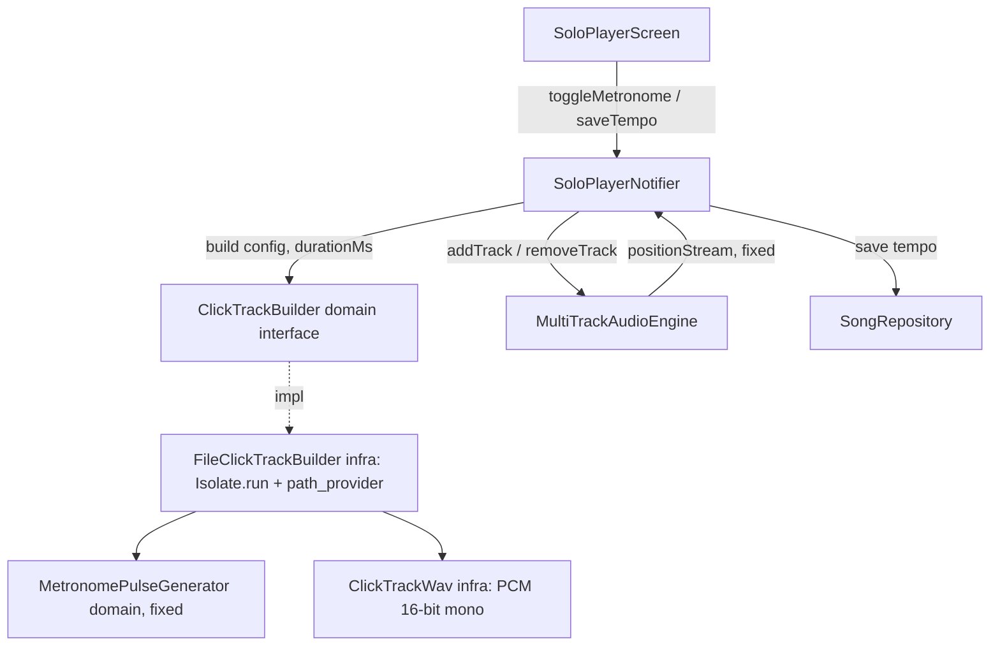

# Metrônomo solo (solo-metronome) Design

**Spec**: `.specs/features/solo-metronome/spec.md`
**Context**: `.specs/features/solo-metronome/context.md`
**Status**: Draft

---

## Architecture Overview

**Chosen approach (A): click track.** The click is rendered into a WAV file that is as long as the song, with one short beep at each pulse of `MetronomePulseGenerator`. The engine plays it as one more track with `startDelayMs: 0`. Because it is just another player on the shared timeline:
- `playAt`, `pause`, `seekAllTo` and the loop's reposition move it with the voices for free;
- `setTrackVolume` and `setTrackMuted` give the P4 mix with no new audio code.

Two other approaches were considered:
- **(B)** A short click sample fired by timers off the position stream. Rejected: on Android each `play()` of a sample has tens of ms of variable latency, and timers drift. It also needs its own pause/seek/loop logic.
- **(C)** Mixing the click into the voices' audio. Rejected: just_audio plays files and offers no mixing graph.

---

## Code Reuse Analysis

### Existing Components to Leverage

| Component | Location | How to Use |
| --------- | -------- | ---------- |
| `MetronomePulseGenerator` | `lib/domain/audio/metronome_pulse_generator.dart` | Pulse positions and downbeats (fixed for drift in T3) |
| `MetronomeConfig` | `lib/domain/entities/metronome_config.dart` | BPM, beats per measure, accent, `enabledByDefault`; bounds already asserted |
| `SongMapper` metronome columns | `lib/data/mappers/song_mapper.dart:13-39` | Persisting the tempo needs no schema change |
| `MultiTrackAudioEngine` | `lib/infrastructure/audio/multi_track_audio_engine.dart` | Gains `addTrack` / `removeTrack`; mute/volume rules already apply per track |
| `SoloPlayerNotifier` / `SoloPlayerScreen` | `lib/presentation/...solo_player...` | Extended, not replaced |
| `MixTrackRow` | `lib/presentation/widgets/mix_track_row.dart` | Metronome row (`naipe: null`, label "Metrônomo"), with a new `showSolo: false` |
| `TonalButton`, `PrimaryButton`, `SegmentedControl`, `InlineBanner`, `Toast` | `lib/presentation/widgets/` | Footer button, tempo sheet |
| `LyricsEditorNotifier.save` | `lib/presentation/providers/lyrics_editor_notifier.dart:360-403` | Pattern for rebuilding the `Song` and invalidating `songsProvider` / `songByIdProvider` |
| `FakeJustAudioPlatform` | `test/infrastructure/audio/fakes/` | Gains a mode where `play` answers only on pause (the Android contract), for T1 |

### Integration Points

| System | Integration Method |
| ------ | ------------------ |
| Audio engine | New `addTrack(SongTrack)`, `removeTrack(String)`; fixed `playAt` and `positionMs` |
| Database | `SongRepository.save(song)` with a new `metronomeConfig`; columns exist since Phase 2 |
| Filesystem | WAV written under `getTemporaryDirectory()` (`path_provider`, already a dependency) as `metronome_<songId>.wav`, overwritten on each build |

---

## Components

### Fix 1: `MultiTrackAudioEngine.playAt` starts every track at once (T1)

- **Change**: send `play()` to every player without awaiting each one. Each call is `unawaited(player.play())`, with errors swallowed per player so a single failing player cannot stop the others. Mirrors `just_audio`'s documented contract: the future completes only on pause, stop or completion.
- **Test double**: `FakeAudioPlayerPlatform.holdPlayUntilPause`. When true, `play()` answers only when `pause()` is called, like the Android implementation (`AudioPlayer.java:965-979`).

### Fix 2: position from `positionStream` (T2)

- **Change**: the reference player's `positionStream` (every 16–200 ms while playing) feeds `positionMs` instead of `playbackEventStream.updatePosition`. The reference choice (longest track) is unchanged.

### Fix 3: `MetronomePulseGenerator` without drift (T3)

- **Change**: pulse `n` is at `(n * 60000 / bpm).round()`. The first pulse is the smallest `n` whose position is `>= startMs`.

### `AudioPlaybackEngine.addTrack` / `removeTrack` (T4)

- **Interfaces**:
  - `Future<void> addTrack(SongTrack track)`: loads one more player with the same per-track state as `loadSong` (volume 1.0, not muted). It does not change the position reference.
  - `Future<void> removeTrack(String trackId)`: stops and disposes that player and clears its state. A no-op for unknown ids.
- **Ripple**: all 7 test fakes that `implements AudioPlaybackEngine` gain recording no-ops.

### `ClickTrackWav` (infrastructure, pure) (T5)

- **Location**: `lib/infrastructure/audio/click_track_wav.dart`
- **Interface**: `static Uint8List encode({required List<MetronomePulse> pulses, required int durationMs, int sampleRate = 22050})` returns a RIFF/WAVE PCM 16-bit mono file.
  - Silence everywhere except a 30 ms sine burst at each pulse, with a short linear fade-out.
  - The downbeat uses 1500 Hz, other beats 1000 Hz.
  - Total samples = `durationMs × sampleRate / 1000`.
- **Accent rule**: the caller passes the pulses. With the accent off, every pulse has `isDownbeat: false` (`FileClickTrackBuilder` does that mapping).

### `ClickTrackBuilder` (domain interface) + `FileClickTrackBuilder` (infrastructure) (T6)

- **Domain**: `lib/domain/audio/click_track_builder.dart`, `abstract class ClickTrackBuilder { Future<Result<String, Failure>> build({required String songId, required MetronomeConfig config, required int durationMs}); }`. It returns the WAV path or a `PlaybackFailure`. No throw (AD-002).
- **Infrastructure**: `lib/infrastructure/audio/file_click_track_builder.dart`.
  - Generates the pulses and encodes them inside `Isolate.run` (spec Edge Cases: off the UI thread).
  - Writes to `getTemporaryDirectory()/metronome_<songId>.wav`.
  - Maps any exception to `PlaybackFailure(code: 'click_track_build_failed')`.
  - Takes an injectable directory resolver for tests.
- **Provider**: `clickTrackBuilderProvider` in `lib/presentation/providers/click_track_builder_provider.dart` (same shape as `audioPlaybackEngineProvider`).

### `SoloPlayerNotifier` additions (T7)

- **State**:
  - `metronomeOn`: `bool`
  - `metronomeVolume`: `double` (1.0)
  - `metronomeMuted`: `bool`
  - `metronomeError`: `String?`
  - `metronomeBusy`: `bool`
  - `tempoSaveError`: `String?`
- **Getters**:
  - `metronomeConfig`: `song.metronomeConfig`;
  - `canEditTempo`: `song.origin == SongOrigin.created`.
- **Constant**: `metronomeTrackId = 'metronome'`.
- **`toggleMetronome()`**:
  - Off → on:
    1. Requires a config. Set `busy`.
    2. `builder.build(...)`. On failure: `metronomeError = 'Não foi possível preparar o metrônomo.'`, stay off.
    3. If playing, `pause()`.
    4. `addTrack(SongTrack(id: metronomeTrackId, filePath: path, naipe: Naipe.custom))`.
    5. Apply the session volume and mute.
    6. `seekAllTo(positionMs)`; if it was playing, `playAt(now)`.
    7. `metronomeOn = true`.
  - On → off: `removeTrack(metronomeTrackId)`, `metronomeOn = false`. The voices are untouched.
- **`saveTempo(MetronomeConfig config)`**:
  - Requires `canEditTempo`. Builds the `Song` with the new config, keeping the old `enabledByDefault`, and calls `repository.save`.
  - On failure: `tempoSaveError = 'Não foi possível salvar o andamento.'`, return `false`.
  - On success:
    1. Update `song`; invalidate `songsProvider` and `songByIdProvider`.
    2. If the metronome was on, `removeTrack` and turn it on again with the new config (MET-18).
    3. If it was off, turn it on.
    4. Return `true`.
- **`setMetronomeVolume(double)`** / **`toggleMetronomeMute()`**: same as the track mix, on `metronomeTrackId`.
- **After `ready`**: if `metronomeConfig?.enabledByDefault == true`, call `toggleMetronome()` once.

### Shared widget change: `MixTrackRow.showSolo` (T8)

- An optional `showSolo` (default `true`). When `false`, the S toggle is not rendered, so the metronome row has volume + M only.

### `TempoSheet` (new shared widget) (T9)

- **Location**: `lib/presentation/widgets/tempo_sheet.dart`. A bottom sheet (`showModalBottomSheet`, same scrim/radius as `ConfirmSheet`).
- **Contents**:
  - title "Andamento";
  - field "BPM" (numeric, mono, 30–300);
  - field "Tempos por compasso" (numeric, mono, 2–16);
  - `SegmentedControl<bool>` "Com acento" / "Sem acento";
  - `PrimaryButton` "Salvar andamento", disabled while any field is invalid;
  - inline limit messages "Entre 30 e 300" and "Entre 2 e 16";
  - a `saveError` banner.
- **API**: `static Future<void> show(BuildContext, {required MetronomeConfig initial, required Future<String?> Function(MetronomeConfig) onSave})`. `onSave` returns null on success (the sheet closes) or the error message (the sheet stays open, values kept).

### `SoloPlayerScreen` changes (T10)

- **Footer**:
  - row 1: [loop `TonalButton`] [metronome `TonalButton`];
  - row 2: [P] Tocar/Pausar, full width. This keeps 360 dp at 130 % readable with three actions.
- **Metronome button**:
  - label "Metrônomo ♩ `bpm`" with a config, else "Metrônomo";
  - positive when on;
  - created song without config → opens `TempoSheet`;
  - received song without config → disabled, with the caption "Música recebida: só quem criou pode definir o andamento." under the buttons.
- **Body**, after the track mix rows:
  - when on: a `MixTrackRow` "Metrônomo" (`naipe: null`, `showSolo: false`);
  - when `canEditTempo` and a config exist: a caption "`bpm` BPM · `n` tempos" + `TonalButton` "Ajustar andamento" → `TempoSheet` prefilled.
- **Feedback**: `metronomeError` → error banner in the footer. Successful save → `Toast` "Andamento salvo".
- UI_SPEC §6.12 and COMPONENTS.md are updated in the same task.

---

## Data Models

No schema change: `songs.metronome_*` columns already exist. New in-memory state only, as listed above.

---

## Error Handling Strategy

| Error Scenario | Handling | User Impact |
| -------------- | -------- | ----------- |
| WAV build fails (disk full, isolate error) | `FileClickTrackBuilder` → `Result.failure(PlaybackFailure)` | "Não foi possível preparar o metrônomo."; music keeps playing |
| `addTrack` throws (file unreadable) | try/catch in the notifier (infrastructure exception) → same message | Same; the metronome stays off |
| Tempo save fails | `Result.failure` from the repository | Sheet stays open with the values; "Não foi possível salvar o andamento." |
| Invalid BPM / beats | Validated in the sheet before saving | Limit text under the field; save disabled |

---

## Risks & Concerns

| Concern | Location (file:line) | Impact | Mitigation |
| ------- | -------------------- | ------ | ---------- |
| `playAt` awaits each `player.play()`, which on Android completes only on pause | `lib/infrastructure/audio/multi_track_audio_engine.dart:167-175` | On a device only the first track plays: room, solo, align, lyrics | T1, with a fake that holds `play` until pause |
| Position comes from `playbackEventStream` (event-only) | `multi_track_audio_engine.dart:76-81` | The clock freezes during playback on a device | T2: use `positionStream` |
| Integer pulse interval | `lib/domain/audio/metronome_pulse_generator.dart:18` | ~70 ms drift after 3 min at 72 BPM | T3: rounded absolute positions |
| Turning the metronome on while playing needs a pause → add → seek → play | `SoloPlayerNotifier.toggleMetronome` | A short audible gap (load time of one file) | Accepted: the spec asks for alignment before the click sounds (MET-18); recorded as known UX |
| WAV size: 22 050 Hz × 16 bit × duration | `FileClickTrackBuilder` | ~2.6 MB per minute of song in the temp dir | One file per song, overwritten; temp dir is OS-cleanable |
| 7 hand-written fakes implement `AudioPlaybackEngine` | `test/**` | Adding members breaks compilation | T4 updates all of them in the same commit |
| No device verification | — | The T1/T2 fixes rely on the documented `just_audio` contract | Contract-mimicking tests now; device check in the background-playback feature |

---

## Tech Decisions

| Decision | Choice | Rationale |
| -------- | ------ | --------- |
| Click synchronization | Click track on the shared timeline (approach A) | Same precision as the voices; pause/seek/loop for free |
| Click synthesis location | Infrastructure, pure function + isolate | Audio encoding is not domain logic; heavy work off the UI thread (CLAUDE.md) |
| Builder contract | Domain interface returning `Result<String, Failure>` | Keeps the notifier testable with a fake and follows AD-002 (no throw) |
| Sample rate | 22 050 Hz mono 16-bit | A 1–1.5 kHz beep needs no more; halves the file size versus 44.1 kHz |
