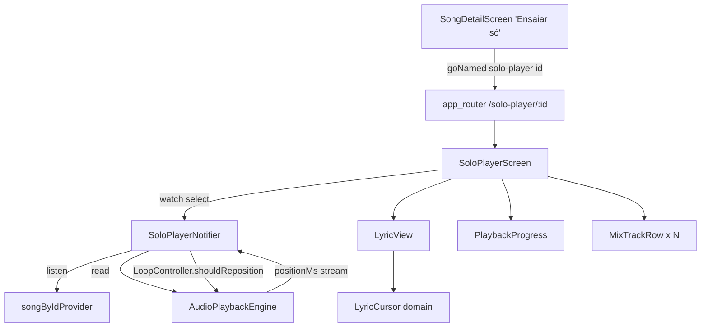

# Modo solo (solo-player) Design

**Spec**: `.specs/features/solo-player/spec.md`
**Context**: `.specs/features/solo-player/context.md`
**Status**: Draft

---

## Architecture Overview

**Chosen approach (A):** one `SoloPlayerNotifier` per screen (`StateNotifierProvider.autoDispose.family`, keyed by `songId`). It owns:
- the playback state;
- the session-only mix;
- the loop.

This is the same shape as `TrackAlignNotifier` and `LyricsEditorNotifier`.

Two other approaches were considered:
- **(B)** Split playback, mix and loop into three notifiers. Rejected: the loop must react to the position stream and command the engine, so the three would need cross-wiring, with no gain.
- **(C)** Extract a shared "playback session" controller for future reuse by the room screens. Rejected as speculative (CLAUDE.md: SOLID without speculation). The room will reuse the *widgets* (`LyricView`, `PlaybackProgress`), not the controller.



---

## Code Reuse Analysis

### Existing Components to Leverage

| Component | Location | How to Use |
| --------- | -------- | ---------- |
| `TrackAlignNotifier` | `lib/presentation/providers/track_align_notifier.dart` | Structural template: `_ref.listen(songByIdProvider, fireImmediately)`, try/catch around `loadSong`, a position subscription that calls `LoopController.shouldReposition` → `seekAllTo`, a non-awaited `cancel()`, and `dispose()` → `engine.stop()` |
| `LyricsEditorNotifier._onSongResult` | `lib/presentation/providers/lyrics_editor_notifier.dart:191-212` | Same `AsyncValue` handling, including the `isLoading && hasValue` guard (regression `2ba116c`) |
| `LoopController` | `lib/domain/audio/loop_controller.dart` | Validates the loop (`isValid`) and decides the reposition (`shouldReposition`, `repositionTarget`) |
| `AudioPlaybackEngine` / `MultiTrackAudioEngine` | `lib/domain/audio/`, `lib/infrastructure/audio/` | Mute and solo already exist (`setTrackMuted`, exclusive `setTrackSolo`); gains `setTrackVolume` |
| `audioPlaybackEngineProvider` | `lib/presentation/providers/audio_playback_engine_provider.dart` | Engine injection; tests override it with a fake |
| `_ToggleButton` (M/S) | `lib/presentation/widgets/track_align_row.dart:228` | Extracted to a public shared widget `MuteSoloToggle` and reused by `TrackAlignRow` and `MixTrackRow` |
| `TrackAlignDuration.format` | `lib/presentation/widgets/track_align_row.dart:42` | `m:ss.s` formatting for the times |
| `VoicePartBadge`, `NavPill`, `InlineBanner`, `EmptyState`, `CantaeScaffold`, `PrimaryButton` | `lib/presentation/widgets/` | Screen composition |
| `_StateScaffold` / `_LoadingBody` / `_NotFoundBody` / `_ErrorBody` | `lib/presentation/screens/lyrics_editor/lyrics_editor_screen.dart` | Same shapes, copied (precedent: each screen keeps its own) |
| `FakeJustAudioPlatform` | `test/infrastructure/audio/fakes/` | Tests `setTrackVolume` on the real engine without a device |

### Integration Points

| System | Integration Method |
| ------ | ------------------ |
| Routing | `/solo-player/:id` (same shape as `track-align`/`lyrics-editor`); `SongDetailScreen` "Ensaiar só" passes `pathParameters: {'id': song.id}` |
| Database | Read only, via `songByIdProvider`. Nothing is persisted |
| Audio engine | `loadSong`, `playAt`, `pause`, `seekAllTo`, `setTrackVolume` (new), `setTrackMuted`, `setTrackSolo`, `durationMs`, `positionMs`, `stop` |

---

## Components

### `AudioPlaybackEngine.setTrackVolume` (domain interface + infrastructure)

- **Purpose**: Per-track volume, applied together with mute and solo.
- **Location**: `lib/domain/audio/audio_playback_engine.dart`, `lib/infrastructure/audio/multi_track_audio_engine.dart`
- **Interfaces**:
  - `Future<void> setTrackVolume(String trackId, double volume)`. The volume is clamped to `0.0..1.0`. The effective volume is `baseGain × volume`, then the existing mute/solo rules apply: when a solo is active, only the soloed track plays, at its own `baseGain × volume`; otherwise a muted track is `0`.
- **Also changes**: the reference track for `positionMs` becomes the loaded track with the greatest `startDelayMs + file duration`, instead of `tracks.first` (see Risks, row 1).
- **Dependencies**: none new.
- **Reuses**: `_effectiveVolume` / `_applyVolume`.
- **Ripple**: all five test fakes that `implements AudioPlaybackEngine` gain a no-op/recording `setTrackVolume`.

### `LyricCursor` (domain)

- **Purpose**: Pure function giving the previous/current/next indexes of timed lyric lines at a given position (spec P4-AC2).
- **Location**: `lib/domain/audio/lyric_cursor.dart`
- **Interfaces**:
  - `static LyricCursorResult at(List<LyricLine> timedLines, int positionMs)` returns `(int? previous, int? current, int? next)`. `timedLines` holds only lines with a non-null `onsetMs`, in lyric order.
    - `current` is the line with the greatest `onsetMs ≤ positionMs`. Ties go to the later line in lyric order.
    - `next` is the first line after `current` in lyric order, or index 0 when `current == null`.
    - `previous` is the line before `current`.
- **Dependencies**: `LyricLine` only (domain pure, AD-001).
- **Reuses**: the `currentLineIndex` rule from `LyricsEditorState` (same rule, kept separate: the editor works on drafts).

### `SoloPlayerNotifier` + `SoloPlayerState`

- **Purpose**: All Modo solo state and commands.
- **Location**: `lib/presentation/providers/solo_player_notifier.dart`
- **State**:
  - `status`: `SoloPlayerStatus { loading, notFound, error, noTracks, audioError, ready }`
  - `song`: `Song?`
  - `durationMs`: `int` (`0` until loaded)
  - `positionMs`: `int`
  - `playing`: `bool`
  - `ended`: `bool` (reached the end; the next play restarts from 0)
  - `mix`: `Map<String, TrackMix>`, where `TrackMix { double volume = 1.0; bool muted = false }`; one entry per loaded track, keyed by `trackId`
  - `soloTrackId`: `String?`
  - `loopStartMs`: `int?` (start marked, end pending)
  - `loop`: `LoopController?` (active loop)
  - `loopError`: `String?`
- **Getters**:
  - `mixTracks`: `List<SongTrack>`, i.e. `song.tracks` followed by `song.playbackTrack`, in engine load order;
  - `canMarkLoop`: `playing && loop == null`.
- **Interfaces**:
  - `retry()`:
    - `error` / `notFound` → invalidate `songByIdProvider`;
    - `audioError` → load the engine again.
  - `togglePlay()`:
    - playing → `pause()`;
    - otherwise: if `ended`, `seekAllTo(0)` and position 0 first; then `playAt(DateTime.now())`.
    - The state flips *before* awaiting the engine, so rapid taps reflect the last tap (spec Edge Cases).
  - `seekTo(int ms)`: clamps to `0..durationMs`, calls `seekAllTo`, updates `positionMs`, clears `ended`. Keeps `playing` as is.
  - `setVolume(String trackId, double volume)`: clamps to `0..1`, updates `mix`, calls `engine.setTrackVolume`.
  - `toggleMute(String trackId)`: flips `muted`, calls `engine.setTrackMuted`.
  - `toggleSolo(String trackId)`: `soloTrackId = same ? null : trackId`, calls `engine.setTrackSolo(trackId, !same)`.
  - `markLoopStart()`: requires `canMarkLoop && loopStartMs == null`; sets `loopStartMs = positionMs`; clears `loopError`.
  - `markLoopEnd()`: requires `playing && loopStartMs != null`; builds `LoopController(startMs, endMs: positionMs, maxMs: durationMs)`.
    - If `!isValid`: sets `loopError = 'O fim do trecho precisa vir depois do início.'` and keeps `loopStartMs`.
    - Otherwise: sets `loop` and clears `loopStartMs`.
  - `clearLoop()`: `loop = null`, `loopStartMs = null`, `loopError = null`. No seek (RF10).
- **Position listener** (subscribed once after `loadSong`):
  1. Update `positionMs`.
  2. If `loop?.shouldReposition(pos)`, call `seekAllTo(loop.repositionTarget)`.
  3. Else if `playing && pos >= durationMs`, call `engine.pause()` and set `playing = false`, `ended = true`, `positionMs = durationMs`.
- **`dispose()`**: cancels the subscription (not awaited) and calls `engine.stop()`.
- **Dependencies**: `songByIdProvider`, `audioPlaybackEngineProvider`.
- **Reuses**: the `TrackAlignNotifier` structure and `LoopController`.

### Shared widgets (new, each in `COMPONENTS.md`)

| Widget | File | Props | Notes |
| ------ | ---- | ----- | ----- |
| `LyricView` | `widgets/lyric_view.dart` | `lines` (`List<LyricLine>`, timed only), `cursor` (`LyricCursorResult`), `userVoicePart` (`Naipe?`, unused when null) | Past line: `lyricPast` in `text3`. Active line: `surface` card, `VoicePartBadge` + "`Naipe` · `dinâmica`", `lyricActive`, live region. Next line: label "Próxima" + `lyricNext`. Before the first line: only "Próxima". |
| `PlaybackProgress` | `widgets/playback_progress.dart` | `positionMs`, `durationMs`, `loopStartMs?`, `loopEndMs?`, `caption?`, `onSeek(int)` | Current and total time in mono (`m:ss.s`). Native `Slider` in `accent`; while dragging it shows the drag value and calls `onSeek` on `onChangeEnd`. Loop region painted in `accentTrack`. Caption below ("Repetindo trecho 0:41–1:12"). Slider semantics: "Posição da música", with the value as time. |
| `MixTrackRow` | `widgets/mix_track_row.dart` | `naipe` (`Naipe?`, null = Playback), `label`, `volume`, `muted`, `solo`, `onVolumeChanged`, `onMuteToggled`, `onSoloToggled` | Selo + name, volume `Slider` (semantics "Volume do `label`", value "`N` %"), and `MuteSoloToggle` M and S (≥ 44 dp). |
| `MuteSoloToggle` | `widgets/mute_solo_toggle.dart` | `label`, `semanticLabel`, `active`, `onTap` | Extracted from `TrackAlignRow._ToggleButton`, with unchanged behavior. `TrackAlignRow` switches to it (its tests guard the refactor). |
| `TonalButton` | `widgets/buttons.dart` | `label`, `onPressed`, `positive` (`bool`) | Per COMPONENTS: `fillOnSurface` (neutral) or `accentSoft` (positive), height 44. Used for the loop actions. |
| `StatusPill` | `widgets/status_pill.dart` | `label` (neutral variant only) | Height 44, live region. Only `neutral` is built now. The `synced`/`weak`/`offline` variants arrive with the room screens. |

`SegmentedControl`-style section labels: the screen uses a local `_SectionLabel` (precedent: `song_detail_screen.dart:318`). Promoting it to a shared `SectionLabel` is outside this feature.

### `SoloPlayerScreen`

- **Location**: `lib/presentation/screens/solo_player/solo_player_screen.dart`
- **Layout** (UI_SPEC §6.12):
  - **Top**: `NavPill` "‹ Voltar" → `song-detail`, and `StatusPill` "Funciona offline".
  - **Title**: song name; subtitle: author.
  - **Body**: `LyricView`, or "Esta música ainda não tem letra sincronizada"; then `_SectionLabel('Mix por naipe')` and one `MixTrackRow` per `mixTracks` entry.
  - **Footer**: `PlaybackProgress`; a `loopError` banner when set; a row with the loop `TonalButton` and `PrimaryButton` "Tocar"/"Pausar".
- **Loop button states**:
  - no loop: "Marcar início do loop" (disabled while paused);
  - start marked: "Marcar fim do loop";
  - loop on: "Desligar loop", positive.
- **State bodies**:

  | Status | Body |
  | ------ | ---- |
  | `loading` | progress indicator |
  | `notFound` | "Música não encontrada" + "Voltar à Biblioteca" |
  | `error` | banner "Não foi possível abrir a música" + "Tentar de novo" |
  | `noTracks` | `EmptyState` "Esta música ainda não tem faixas" + primary "Enviar faixa" → `track-upload` |
  | `audioError` | banner "Não foi possível tocar as faixas desta música." + "Tentar de novo" |

  All bodies except `ready` have no playback footer.
- **Rebuild scope**:
  - the screen watches a `_View` record without `positionMs`;
  - `PlaybackProgress` and `LyricView` each sit in their own `Consumer` that selects `positionMs` (and the loop fields), so position ticks never rebuild the mix rows.
- **Single primary action**: "Tocar"/"Pausar". The loop actions are tonal.

### Routing

- `app_router.dart`: `GoRoute(path: '/solo-player/:id', name: 'solo-player', builder: SoloPlayerScreen(songId: id))`.
- `song_detail_screen.dart:302`: `context.goNamed('solo-player', pathParameters: {'id': song.id})`.

---

## Data Models

```dart
class TrackMix {
  const TrackMix({this.volume = 1.0, this.muted = false});
  final double volume; // 0.0..1.0
  final bool muted;
}

typedef LyricCursorResult = ({int? previous, int? current, int? next});
```

No persistence and no schema change.

---

## Error Handling Strategy

| Error Scenario | Handling | User Impact |
| -------------- | -------- | ----------- |
| Song not found | `NotFoundFailure` → `notFound` | "Música não encontrada" + back to Biblioteca |
| Repository read fails | other `Failure` or `AsyncError` → `error` | Banner + "Tentar de novo" (re-read) |
| Song has no tracks | `mixTracks.isEmpty` → `noTracks` | EmptyState + "Enviar faixa" |
| `loadSong` throws (missing/unreadable file) | try/catch in the notifier (infrastructure exception, not domain) → `audioError` | Banner + "Tentar de novo" (reload the engine) |
| Loop end ≤ start | `LoopController.isValid == false` → `loopError` | Inline error; the start stays marked |

---

## Risks & Concerns

| Concern | Location (file:line) | Impact | Mitigation |
| ------- | -------------------- | ------ | ---------- |
| The position stream follows `tracks.first`. When that track ends before the others, the stream stops emitting. | `lib/infrastructure/audio/multi_track_audio_engine.dart:70-78` | The time freezes and the end of the song is never detected (P1-AC5/AC7). | In the engine task, pick the reference as the track with the greatest `startDelayMs + duration`, with a test. Room playback keeps working: the position is still timeline time. |
| On real devices, the last emitted position may stop a few ms short of `durationMs`. | `multi_track_audio_engine.dart` (`playbackEventStream`) | "Ended" might not fire. | The domain test covers `≥ durationMs`. Device verification is part of the deferred background-playback feature; if it stops short, add a `completed` stream to the engine then. Recorded, not solved here. |
| Five hand-written fakes implement `AudioPlaybackEngine`. | `test/**/_FakeAudioPlaybackEngine`, `test/data/playback/playback_command_handler_test.dart:21` | Adding a member breaks their compilation. | The engine task updates all five in the same commit. |
| Extracting `_ToggleButton` touches `TrackAlignRow`. | `lib/presentation/widgets/track_align_row.dart:228` | Regression risk on a verified screen. | Behavior-preserving extraction; the existing `track_align_row_test.dart` and `track_align_screen_test.dart` must stay green unchanged. |
| A Slider drag that calls `seekAllTo` on every `onChanged` would flood the engine. | `PlaybackProgress` | Choppy audio. | Seek only on `onChangeEnd`; show the drag value locally while dragging. |
| UI_SPEC §6.12's "Sozinha" assumes the user's gender. | `docs/design/UI_SPEC.md:135` | Misgendering. | Use "Funciona offline" and update UI_SPEC in the screen task. |

---

## Tech Decisions

| Decision | Choice | Rationale |
| -------- | ------ | --------- |
| Per-track volume location | Engine (`setTrackVolume`), not the widget | The audio graph is infrastructure; the domain interface keeps the presentation free of `just_audio` (AD-001) |
| End-of-song detection | Notifier compares `positionMs ≥ durationMs` | The engine interface has no "completed" event, and adding one has no other consumer yet |
| Lyric cursor | Pure domain function `LyricCursor` | Reused later by the room's `LyricView` consumers; testable without Flutter |
| M/S semantic labels | "Mudo" / "Solo" (same as `TrackAlignRow`) | Consistency across screens. Spec P2-AC6 is amended from "Isolado" to "Solo" |
