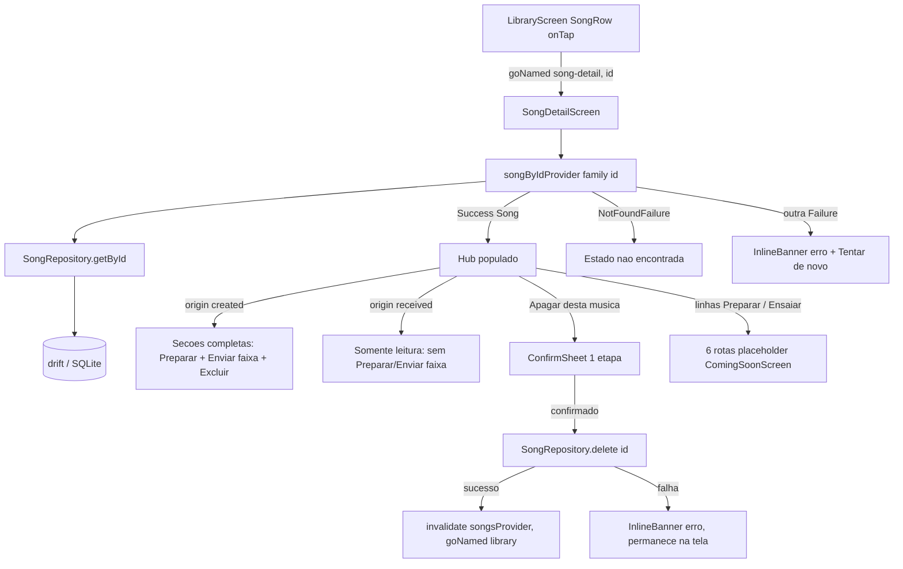

# Tela Detalhe da música Design

**Spec**: `.specs/features/song-detail-screen/spec.md`
**Status**: Draft

---

## Architecture Overview

`SongDetailScreen` is a `go_router` destination (`song-detail`, already registered) that reads `id` from the route, loads one `Song` via a new family provider, and renders one of 4 bodies: carregando, não encontrada, erro, ou o hub populado (que por sua vez varia por `origin`). A exclusão é uma ação local da tela (sem novo `StateNotifier`): chama o repositório direto, trata o resultado, e navega/mostra erro.

---

## Approach Exploration

### Carregar a música por id

| Approach | Description | Trade-off |
| --- | --- | --- |
| **A — `FutureProvider.family<Result<Song, Failure>, String>` (recomendado)** | Novo provider devolve o `Result` crú do repositório, sem lançar. A tela faz `switch` direto em `Success`/`NotFoundFailure`/outra `Failure`, mais o `loading`/`error` de transporte do próprio `AsyncValue`. | É uma pequena divergência do padrão de `songsProvider` (que lança em falha). Necessária porque aqui há 3 desfechos de negócio distintos (dado, não encontrada, erro real) e "não encontrada" não é uma falha de infraestrutura — forçar isso em `AsyncValue.error` misturaria os dois conceitos. |
| B — lançar e discriminar pelo tipo da exceção em `AsyncValue.error` | Mantém o padrão de `songsProvider` (lança `StateError(failure.code)`), e a tela olha `error is NotFoundFailure` dentro do `error:` callback. | Reaproveita o padrão existente, mas transforma um estado de negócio válido ("música não existe") num "erro" de framework — esconde a distinção que a spec exige (ACs 4 e 5 são claramente diferentes). |
| C — dois providers separados (`songExistsProvider<bool>` + `songProvider<Song?>`) | Separa existência de conteúdo. | Duas chamadas ao repositório ou um provider derivado complicado; mais código para o mesmo resultado que A entrega em uma função. |

**Escolha: A.** É a única que representa os 3 desfechos (dado / não encontrada / erro) como 3 estados de primeira classe, sem sobrecarregar a semântica de erro do `AsyncValue`.

### Estado da exclusão

| Approach | Description | Trade-off |
| --- | --- | --- |
| **A — estado local no `ConsumerStatefulWidget` da tela (recomendado)** | Um `String?` de erro e nada mais; a ação chama `songRepositoryProvider` direto, trata o `Result`, navega ou seta o erro local. | É uma ação única, disparada uma vez, sem mais telas consumindo esse estado. Um `StateNotifier`/provider novo para isso seria abstração sem segundo consumidor. |
| B — novo `songDeletionProvider` (StateNotifier) | Centraliza o estado de exclusão num provider. | Nenhum outro widget precisa observar "exclusão em andamento" — especulativo para o escopo atual. |

**Escolha: A**, consistente com a regra do projeto de não introduzir abstração para uso hipotético futuro.

---

## Code Reuse Analysis

### Existing Components to Leverage

| Component | Location | How to Use |
| --- | --- | --- |
| `CantaeScaffold` | `lib/presentation/widgets/cantae_scaffold.dart` | Casca da tela (`topLeft`: `NavPill.back`; `topRight`: `NavPill.action` "Exportar"; `footer`: Ensaiar só/em grupo). Já tem `Material` próprio — nenhum workaround necessário. |
| `NavPill` | `lib/presentation/widgets/nav_pill.dart` | `back` ("‹ Biblioteca") e `action` ("Exportar"). |
| `VoicePartBadge` | `lib/presentation/widgets/voice_part_badge.dart` | Uma por naipe padrão (`filled`/`missing`), igual ao padrão já usado em `SongRow`. |
| `PrimaryButton` / `SecondaryButton` | `lib/presentation/widgets/buttons.dart` | Rodapé: `SecondaryButton` "Ensaiar só", `PrimaryButton` "Ensaiar em grupo". |
| `InlineBanner` | `lib/presentation/widgets/inline_banner.dart` | Variante `error` para falha de carregamento e falha de exclusão (ação "Tentar de novo" / dispensar). |
| `EmptyState` | `lib/presentation/widgets/empty_state.dart` | Estado "Música não encontrada" (ícone + título + ação "Voltar à Biblioteca"), igual ao uso em `ComingSoonScreen`. |
| `ComingSoonScreen` | `lib/presentation/screens/coming_soon/coming_soon_screen.dart` | Destino das 6 novas rotas placeholder — já genérico, não precisa mudar. |
| `songRepositoryProvider` | `lib/presentation/providers/song_repository_provider.dart` | `getById`, `delete` — ambos já existem e já distinguem `NotFoundFailure`. |
| `songsProvider` | `lib/presentation/providers/library_providers.dart` | `ref.invalidate(songsProvider)` após excluir, para a Biblioteca não mostrar a música apagada ao voltar. |
| Mapas privados "naipe → nome/VoicePart" | `lib/presentation/widgets/song_row.dart` (`_naipeName`, `_voicePartFor`, `_standardOrder`) | Mesmo mapeamento é reconstruído localmente na nova tela (4 `case`s) — duplicação pequena e deliberada; não extraída para não criar uma abstração compartilhada com um único outro consumidor até hoje. Ver Risks & Concerns. |

### Integration Points

| System | Integration Method |
| --- | --- |
| `go_router` (`routerProvider`) | 6 `GoRoute`s novos (`solo-player`, `studio`, `track-align`, `lyrics-editor`, `song-history`, `track-upload`), todos `ComingSoonScreen`; `song-detail` passa a apontar para `SongDetailScreen` em vez do placeholder. |
| `SongRepository` (drift) | Sem mudança de schema/contrato — só novos chamadores de `getById`/`delete`, que já existem. |

---

## Components

### `songByIdProvider`

- **Purpose**: Carrega uma música por id, expondo o `Result` crú (ver Approach A).
- **Location**: `lib/presentation/providers/song_detail_providers.dart`
- **Interfaces**:
  - `FutureProvider.family<Result<Song, Failure>, String> songByIdProvider` — `ref.watch(songByIdProvider(id))` devolve `AsyncValue<Result<Song, Failure>>`.
- **Dependencies**: `songRepositoryProvider`.
- **Reuses**: `SongRepository.getById`.

### `ConfirmSheet`

- **Purpose**: Folha inferior de confirmação para ações irreversíveis, por `COMPONENTS.md`. Única instância usada nesta feature: exclusão de música (1 etapa, sem confirmação digitada).
- **Location**: `lib/presentation/widgets/confirm_sheet.dart`
- **Interfaces**:
  - `static Future<bool> show(BuildContext context, {required String title, required String message, required String safeLabel, required String destructiveLabel, int steps = 1, String? typedConfirmation})` — devolve `true` só se o usuário confirmar a última etapa; `false`/`null` em qualquer cancelamento.
- **Dependencies**: `showModalBottomSheet`, `CantaeColors.scrim`.
- **Reuses**: nada ainda — primeiro consumidor; construído para o shape completo do componente (1 ou 2 etapas + confirmação digitada) porque `COMPONENTS.md`/`AGENTS.md` já exigem essa forma para o futuro fluxo "apagar todos os dados", não é escopo inventado aqui.

### `DestructiveButton`

- **Purpose**: Botão destrutivo nas duas variantes do `COMPONENTS.md`: `tonal` (inicia o fluxo) e `solid` (confirma).
- **Location**: `lib/presentation/widgets/buttons.dart` (mesmo arquivo de `PrimaryButton`/`SecondaryButton` — já é o padrão de "botões de pílula de altura fixa num arquivo só").
- **Interfaces**:
  - `DestructiveButton({required String label, required VoidCallback? onPressed, DestructiveButtonVariant variant = DestructiveButtonVariant.tonal})`
- **Dependencies**: `CantaeColors.dangerBg`/`onDanger` (tonal), `dangerSolid`/branco (solid).
- **Reuses**: mesmo padrão visual/semântico de `PrimaryButton` (altura 54, `Semantics(button: true)`, `InkWell` com `borderRadius`).

### `SongDetailScreen`

- **Purpose**: A tela em si — orquestra os 4 estados e os dois modos (edição/somente leitura).
- **Location**: `lib/presentation/screens/song_detail/song_detail_screen.dart`
- **Interfaces**: `SongDetailScreen({required String songId})` — `ConsumerStatefulWidget` (estado local só para o erro de exclusão).
- **Dependencies**: `songByIdProvider`, `songRepositoryProvider`, `songsProvider` (para invalidar), `go_router`.
- **Reuses**: todos os componentes listados em Code Reuse Analysis.

---

## Data Models

Nenhum modelo novo. `Song`, `SongTrack`, `SongOrigin`, `SongRepository` já cobrem tudo que esta tela precisa (ver spec's Assumptions — duração e contagem de ensaios ficaram de fora deliberadamente).

---

## Error Handling Strategy

| Error Scenario | Handling | User Impact |
| --- | --- | --- |
| `id` não corresponde a nenhuma música (`NotFoundFailure`) | `songByIdProvider` resolve `Result.failure(NotFoundFailure)`; tela renderiza `EmptyState` dedicado. | Vê "Música não encontrada" + botão "Voltar à Biblioteca". Cobre também o caso `id: 'new'`. |
| Falha de repositório ao buscar (qualquer outra `Failure`) | Tela renderiza `InlineBanner` variante `error` com ação. | Vê erro + "Tentar de novo" (`ref.invalidate(songByIdProvider(id))`). |
| Falha ao excluir (`delete` retorna `Failure`) | Estado local da tela guarda a mensagem; `ConfirmSheet` já fechou, mas a navegação de volta não acontece. | Permanece na tela do Detalhe com um `InlineBanner` de erro; a música não é removida. |
| `id` é a string placeholder `'new'` | Mesmo caminho do "não encontrada" — nenhuma lógica especial. | Idêntico ao caso de id inexistente. |

---

## Risks & Concerns

| Concern | Location (file:line) | Impact | Mitigation |
| --- | --- | --- | --- |
| Mapeamento "naipe → nome/VoicePart" duplicado (já existe em `SongRow`, vai existir de novo aqui) | `lib/presentation/widgets/song_row.dart:30-56` | Duas cópias do mesmo `switch` de 4 casos; se um naipe novo for adicionado, as duas precisam ser lembradas. | Aceitável no tamanho atual (4 casos, baixa taxa de mudança — `Naipe` é um enum estável). Se um terceiro consumidor aparecer, extrair para `lib/presentation/theme/voice_part_colors.dart` ou um helper dedicado nesse momento, não antes. |
| Nenhuma tela ainda roda em dispositivo/emulador real neste projeto (só testes de widget automatizados, herdado de `library-screen`) | — | Specs visuais (espaçamento real, toque em telas pequenas) não são validadas visualmente. | Mesma lacuna já registrada no handoff da feature anterior; fora do escopo corrigir aqui. Os testes de widget cobrem estrutura/semântica, não pixel-perfect. |

> Nenhum risco bloqueante encontrado além dos dois acima, ambos com mitigação por aceitação deliberada.

---

## Tech Decisions

| Decision | Choice | Rationale |
| --- | --- | --- |
| Forma do `songByIdProvider` | `FutureProvider.family<Result<Song, Failure>, String>`, expõe o `Result` crú (não lança) | Única forma de representar "não encontrada" como estado de negócio distinto de "erro de infraestrutura" sem sobrecarregar `AsyncValue.error` (ver Approach Exploration). |
| Estado da exclusão | Local ao widget da tela, sem novo provider/`StateNotifier` | Ação única, um consumidor; evita abstração para uso hipotético (regra do projeto). |
| `ConfirmSheet` construído para o shape completo do componente (1/2 etapas + confirmação digitada) | Sim, mesmo só usando a variante de 1 etapa agora | `COMPONENTS.md` já define o componente assim para o futuro fluxo de "apagar todos os dados"; construir a forma parcial agora só geraria retrabalho quando esse fluxo chegar. |
| Novas rotas placeholder | Adicionadas direto em `app_router.dart`, mesmo `GoRouter` plano (sem sub-router) | Segue AD-012 à risca — rotas nomeadas, um único `GoRouter`, sem introduzir navegação aninhada antes de haver necessidade real. |

---
