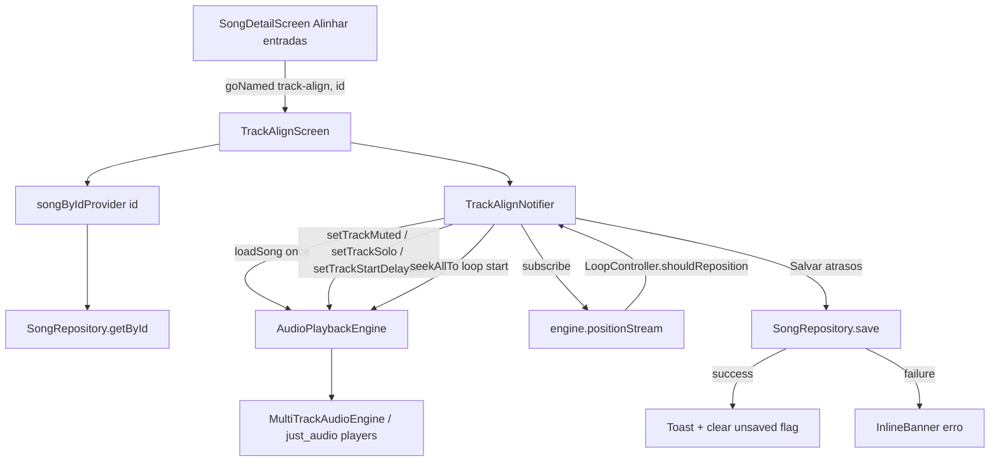

# Tela Alinhamento de faixas Design

**Spec**: `.specs/features/track-align-screen/spec.md`
**Status**: Draft

---

## Architecture Overview

`TrackAlignScreen` is a new `go_router` destination (`track-align`, gains a `:id` segment) that loads the `Song` via the existing `songByIdProvider` (reused from `song-detail-screen`) and drives a new `TrackAlignNotifier` (presentation-layer `StateNotifier`) that owns: draft per-track `startDelayMs` edits, mute/solo state, the marked loop region, play/stop state, and the unsaved-changes flag. The notifier is the *only* new piece that talks to `AudioPlaybackEngine` directly — the screen itself only renders `TrackAlignState` and dispatches intents.

`AudioPlaybackEngine` (domain interface) and `MultiTrackAudioEngine` (its `just_audio`-backed implementation) gain 5 new members to make mudo/solo/loop-test possible; every existing consumer (`PlaybackCommandHandler`, `BackgroundAudioHandler`) keeps compiling unchanged since nothing already there is removed or re-typed.

---

## Approach Exploration

### Onde fica a lógica que liga `LoopController` ao motor de áudio

| Approach | Description | Trade-off |
| --- | --- | --- |
| **A — dentro do `TrackAlignNotifier`, camada de apresentação (recomendado)** | O próprio `StateNotifier` da tela assina `engine.positionStream`, chama `LoopController.shouldReposition`/`repositionTarget`, e aciona `engine.seekAllTo`. | É lógica específica desta tela (nenhum outro consumidor hoje); colocá-la num notifier de apresentação é proporcional. O `LoopController` continua puro no domínio — só o *uso* dele fica na apresentação. |
| B — nova classe em `lib/data/playback/` (como `PlaybackCommandHandler`) | Replica o padrão existente de coordenador em `data/`. | `PlaybackCommandHandler` existe em `data/` porque é compartilhado entre mensagens de rede e o motor — aqui não há rede nem segundo consumidor. Criar uma classe em `data/` para um único chamador seria abstração antecipada. |

**Escolha: A.** Sem um segundo consumidor real, a divisão em `data/` não se paga ainda; fica fácil de extrair depois se a Sala do Mestre vier a precisar da mesma lógica de trecho marcado.

### Como testar um atraso editado sem recarregar o áudio

| Approach | Description | Trade-off |
| --- | --- | --- |
| **A — novo método `setTrackStartDelayMs` que só atualiza o mapa interno (recomendado)** | O motor guarda `startDelayMs` por faixa num mapa (já existe para o cálculo de `seekAllTo`); editar só atualiza esse mapa. O efeito aparece no próximo `seekAllTo` (reinício do loop), não instantaneamente. | Pequeno atraso perceptível até o próximo reinício do trecho — aceitável para um fluxo de ajuste iterativo (o usuário ajusta, o loop reinicia em poucos segundos). |
| B — chamar `loadSong` de novo a cada edição | Reaproveita a lógica existente de carregamento. | `loadSong` descarta e recria todos os `AudioPlayer`s (`_disposeAllPlayers`) — isso pararia a reprodução e perderia a posição atual a cada tecla digitada. Errado para este caso de uso. |

**Escolha: A.**

---

## Code Reuse Analysis

### Existing Components to Leverage

| Component | Location | How to Use |
| --- | --- | --- |
| `songByIdProvider` | `lib/presentation/providers/song_detail_providers.dart` | Mesmo provider da tela de Detalhe — carrega a música por id, já distingue não-encontrada de erro real. |
| `songRepositoryProvider` | `lib/presentation/providers/song_repository_provider.dart` | `save()` para persistir os atrasos. |
| `ConfirmSheet` | `lib/presentation/widgets/confirm_sheet.dart` | Confirmação de "alterações não salvas" ao voltar (1 etapa, já construído na feature anterior). |
| `InlineBanner` | `lib/presentation/widgets/inline_banner.dart` | Erro de carregamento do motor e erro ao salvar. |
| `EmptyState` | `lib/presentation/widgets/empty_state.dart` | Estado "Sem faixas" e "não encontrada". |
| `CantaeScaffold`, `NavPill`, `VoicePartBadge`, `PrimaryButton`/`SecondaryButton` | `lib/presentation/widgets/` | Casca da tela, topo, selo de naipe, rodapé. |
| `AudioPlaybackEngine` / `MultiTrackAudioEngine` | `lib/domain/audio/`, `lib/infrastructure/audio/` | Estendidos (ver abaixo), não recriados. |
| `LoopController` | `lib/domain/audio/loop_controller.dart` | Primeiro consumidor real — `isValid`/`shouldReposition`/`repositionTarget`, sem mudar a classe. |
| `TimelineConverter` | `lib/domain/audio/timeline_converter.dart` | Reaproveitado dentro do motor para converter a posição do player de referência para tempo de timeline. |
| Mapeamento naipe → nome/`VoicePart` | privado em `song_row.dart`/`song_detail_screen.dart` | Mesmo padrão replicado (4 casos) — duplicação já aceita em features anteriores. |

### Integration Points

| System | Integration Method |
| --- | --- |
| `go_router` (`routerProvider`) | `track-align` ganha o segmento `:id`; `song_detail_screen.dart`'s linha "Alinhar entradas" passa a enviar `pathParameters: {'id': song.id}`. |
| `AudioPlaybackEngine` (domain) | 5 novos membros (ver Components) — nenhum membro existente muda de assinatura. |
| `SongRepository` | Sem mudança de contrato — só um novo chamador de `save()`. |

---

## Components

### `AudioPlaybackEngine` (estendido)

- **Purpose**: Acrescenta mudo/solo/atraso-ao-vivo/posição/duração por faixa, necessários para o teste desta tela.
- **Location**: `lib/domain/audio/audio_playback_engine.dart`
- **Interfaces** (novos membros; os 5 existentes não mudam):
  - `Future<void> setTrackMuted(String trackId, bool muted)`
  - `Future<void> setTrackSolo(String trackId, bool solo)` — ativar solo numa faixa desativa o solo de qualquer outra (exclusivo).
  - `Future<void> setTrackStartDelayMs(String trackId, int startDelayMs)` — só atualiza o atraso usado por `seekAllTo`; não recarrega o arquivo.
  - `int? get durationMs` — `null` antes de `loadSong` completar; depois, o maior `startDelayMs + duração do arquivo` entre as faixas carregadas (timeline inteira, não só o arquivo).
  - `Stream<int> get positionMs` — posição atual na timeline (não no arquivo local), derivada de uma faixa de referência via `TimelineConverter.toTimeline`.
- **Dependencies**: nenhuma nova.
- **Reuses**: `TimelineConverter`, `AudioMixCalculator` (já usados).

### `MultiTrackAudioEngine` (estendido)

- **Purpose**: Implementação real dos 5 novos membros usando `just_audio`.
- **Location**: `lib/infrastructure/audio/multi_track_audio_engine.dart`
- **Interfaces**: implementa os 5 novos membros da interface.
- **Dependencies**: `just_audio` (já declarado).
- **Reuses**: guarda agora também o ganho-base por faixa (`_baseGainByTrackId`, calculado em `loadSong`) para recompor o volume efetivo (`baseGain × (mudo/solo)`) sem perder o ganho original ao mutar/dar solo.

### `audioPlaybackEngineProvider` (novo)

- **Purpose**: Primeiro provider Riverpod para o motor de áudio (hoje ele só é instanciado manualmente por `BackgroundAudioHandler`, fora da árvore de providers).
- **Location**: `lib/presentation/providers/audio_playback_engine_provider.dart` (novo arquivo)
- **Interfaces**: `Provider<AudioPlaybackEngine>` → `MultiTrackAudioEngine()`, com `ref.onDispose` chamando `.dispose()`.
- **Dependencies**: nenhuma.
- **Reuses**: `MultiTrackAudioEngine`.

### `TrackAlignNotifier` + `TrackAlignState` (novo)

- **Purpose**: Orquestra carregamento do motor, edições de atraso, mudo/solo, trecho de loop, reposicionamento de loop e salvar/descartar.
- **Location**: `lib/presentation/providers/track_align_notifier.dart` (novo arquivo)
- **Interfaces**:
  - `StateNotifierProvider.family<TrackAlignNotifier, TrackAlignState, String> trackAlignProvider`
  - Métodos: `setOffset(trackId, ms)`, `setMuted(trackId, bool)`, `setSolo(trackId, bool)`, `setLoopStart(ms)`, `setLoopEnd(ms)`, `toggleTest()`, `save()`, `discard()`.
- **Dependencies**: `songByIdProvider`, `songRepositoryProvider`, `songsProvider` (invalidar após salvar, como no Detalhe), `audioPlaybackEngineProvider`.
- **Reuses**: `LoopController`, `SongTrack` (reconstruído com o novo `startDelayMs` ao salvar).

### `TrackAlignScreen` (novo)

- **Purpose**: A tela em si — todos os estados do spec.
- **Location**: `lib/presentation/screens/track_align/track_align_screen.dart`
- **Interfaces**: `TrackAlignScreen({required String songId})`.
- **Dependencies**: `trackAlignProvider`.
- **Reuses**: todos os componentes listados acima + `TrackAlignRow`/`Toast` (novos, abaixo).

### `TrackAlignRow` (novo componente compartilhado)

- **Purpose**: Uma linha por naipe, por `COMPONENTS.md` — selo, nome, campo de atraso `mm:ss.s`, botões M/S, onda estilizada deslocada.
- **Location**: `lib/presentation/widgets/track_align_row.dart`
- **Interfaces**: `TrackAlignRow({required Naipe naipe, required int startDelayMs, required bool muted, required bool solo, required ValueChanged<int> onOffsetChanged, required ValueChanged<bool> onMuteChanged, required ValueChanged<bool> onSoloChanged})`.
- **Dependencies**: nenhuma.
- **Reuses**: `VoicePartBadge` (selo do naipe).

### `Toast` (novo componente compartilhado)

- **Purpose**: Feedback "Atrasos salvos", por `COMPONENTS.md` (fundo `toastBg`, raio 14, check à esquerda, ~2,5 s).
- **Location**: `lib/presentation/widgets/toast.dart`
- **Interfaces**: `static void show(BuildContext context, String message)` — insere um `OverlayEntry` que se remove automaticamente após ~2,5 s (sem depender de `ScaffoldMessenger`, já que `CantaeScaffold` não é um `Scaffold` padrão).
- **Dependencies**: nenhuma.
- **Reuses**: nada ainda — primeiro consumidor.

---

## Data Models

Nenhuma entidade nova. `SongTrack.startDelayMs` já existe (reconstruído, não um campo novo); `Song` é reconstruído por `save()` com a lista de `tracks` atualizada, igual ao padrão já usado em `song-detail-screen` para `markRehearsed`/exclusão.

---

## Error Handling Strategy

| Error Scenario | Handling | User Impact |
| --- | --- | --- |
| `id` não encontrado | Mesmo caminho do Detalhe (`NotFoundFailure`). | `EmptyState` "não encontrada" + voltar à Biblioteca. |
| Música sem nenhuma faixa | Estado dedicado, sem chamar o motor. | `EmptyState` "Sem faixas" + ir ao Studio/Enviar faixa. |
| `engine.loadSong` lança (arquivo ausente/corrompido) | Capturado pelo `TrackAlignNotifier`, que não entra no estado "carregado". | `InlineBanner` erro + "Tentar de novo" (tenta `loadSong` de novo). |
| `SongRepository.save` falha | Estado permanece com a marca de não salvo. | Aviso de erro inline; o usuário pode tentar salvar de novo. |

---

## Risks & Concerns

| Concern | Location (file:line) | Impact | Mitigation |
| --- | --- | --- | --- |
| `MultiTrackAudioEngine` não tem nenhum teste hoje | `lib/infrastructure/audio/multi_track_audio_engine.dart` (arquivo inteiro) | Estender uma classe sem rede de segurança de testes existente aumenta o risco de regressão silenciosa nos métodos já existentes (`loadSong`, `seekAllTo`). | Esta feature adiciona testes para os 5 métodos novos e, por tocar `loadSong` (para guardar `_baseGainByTrackId`), também cobre `loadSong`/`seekAllTo` básicos — eleva o piso de cobertura da classe como efeito colateral necessário, sem expandir para testar tudo que já existia antes. |
| `durationMs`/`positionMs` dependem de uma "faixa de referência" (a primeira carregada) | `multi_track_audio_engine.dart` (novo código) | Se essa faixa específica falhar ao carregar enquanto outras funcionam, a posição/duração reportada fica incorreta. | Fora do escopo desta feature tratar carregamento parcial faixa-a-faixa — `loadSong` já falha (lança) na primeira faixa que der erro, então "carregado com sucesso" já implica todas as faixas prontas, referência incluída. |
| Editar o atraso durante o teste só faz efeito no próximo reinício do loop (não instantâneo) | `track_align_notifier.dart` (novo) | Pequena espera entre editar e ouvir o efeito. | Documentado como Tech Decision (ver Approach Exploration); aceitável para um fluxo de ajuste iterativo. |

> Nenhum risco bloqueante — todos têm mitigação por aceitação deliberada ou cobertura de teste.

---

## Tech Decisions

| Decision | Choice | Rationale |
| --- | --- | --- |
| Onde fica a lógica de reposicionamento do loop | `TrackAlignNotifier` (apresentação), não uma nova classe em `data/playback/` | Único consumidor hoje; evita abstração antecipada (ver Approach Exploration). |
| Como editar o atraso sem reiniciar o áudio | Novo `setTrackStartDelayMs` que só atualiza o mapa interno do motor | `loadSong` recriaria todos os `AudioPlayer`s a cada tecla digitada — errado para este fluxo. |
| Faixa de referência para posição/duração | A primeira faixa carregada por `loadSong` (ordem de `song.tracks` + `playbackTrack`, mesma ordem já usada hoje) | Simples e suficiente — a timeline é compartilhada por definição (`prd-cantae-refatorado.md` §8.1), então qualquer faixa carregada reporta a mesma posição relativa. |
| `audioPlaybackEngineProvider` | Novo `Provider<AudioPlaybackEngine>` — primeiro ponto do motor na árvore do Riverpod | O motor nunca foi exposto a um provider antes (só instanciado manualmente por `BackgroundAudioHandler`); esta tela é a primeira consumidora via apresentação. |
| Persistência | Reconstrução manual do `Song`/`SongTrack` (sem `copyWith`) | Consistente com o padrão já usado nas duas features anteriores; um `copyWith` de uso único seria abstração especulativa — se um terceiro chamador aparecer, extrair então. |

---
