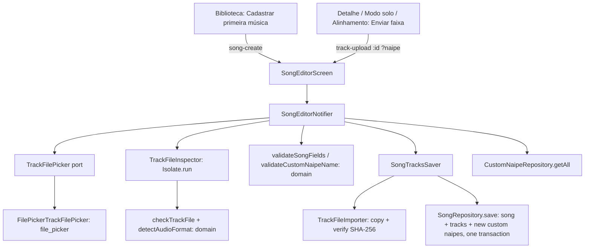

# Cadastrar música e enviar faixas Design

**Spec**: `.specs/features/track-upload/spec.md`
**Status**: Approved

---

## Approaches for the custom naipe

All three deliver the same scope (UPL-01..23). The only difference is how a track names its custom naipe and where the reusable list lives.

| # | Approach | Pros | Cons |
| - | -------- | ---- | ---- |
| **A (recommended)** | New `custom_naipes` table (id, name). `song_tracks.custom_naipe_id` is a nullable FK. `Naipe.custom` stays and means "see `customNaipe`". | Matches the PRD's `SongTrack.naipeId` (UUID). The list outlives the songs that use it. A future rename touches one row. | One extra batched query when loading songs. |
| B | Store the name on the track (`song_tracks.custom_name`). The list is `SELECT DISTINCT custom_name`. | No new table. | The list loses a name when its last song is deleted, which breaks "reutilizáveis" (RF17). A rename means rewriting every track. |
| C | Replace the `Naipe` enum with a `naipeId` string everywhere (PRD literal). | Closest to the PRD model. | Touches session messages, lyrics, mixer and room code, which is far outside this feature. |

**Chosen: A.**

---

## Architecture Overview



**Flow:**
- **Pick:** picker → inspector. The inspector reads the size, the first 12 bytes and a streamed SHA-256 off the UI thread. The domain checks the size and signature. The slot becomes `chosen` or `rejected`.
- **Save:** for each new file, the importer copies it to `library/tracks/<sha>.<ext>.part`, hashes the copy off the UI thread and renames it on a match. A file already at the final path whose hash matches is reused.
  - The repository then saves the song, its tracks and any new custom naipes in one transaction.
  - If anything fails, every file this save created is deleted.

---

## Code Reuse Analysis

### Existing Components to Leverage

| Component | Location | How to Use |
| --------- | -------- | ---------- |
| `LibraryStoragePaths.resolveLibraryRoot` / `trackFilePath` | `lib/data/transfer/library_storage_paths.dart` | Final content-addressed path, the same one received tracks use |
| `ChunkPlanner.maxTransferableSizeBytes` | `lib/domain/transfer/chunk_planner.dart:2` | The 100 MB limit (single source) |
| `crypto` `sha256` | already a dependency | Streamed via `sha256.bind(file.openRead())` |
| `uuidV4` | `lib/data/ids/uuid_v4.dart` | Ids for songs, tracks, custom naipes |
| `DriftSongRepository` save/load | `lib/data/repositories/drift_song_repository.dart` | Extended for the custom naipe; same delete + reinsert of tracks |
| `ConfirmSheet`, `InlineBanner`, `EmptyState`, `NavPill`, `CantaeScaffold`, `PrimaryButton`, `SecondaryButton`, `Toast` | `lib/presentation/widgets/` | Screen building blocks |
| `VoicePartBadge` | `lib/presentation/widgets/voice_part_badge.dart` | New `custom` variant (neutral colours, initial) |
| `naipe_labels.dart` | `lib/presentation/widgets/naipe_labels.dart` | Becomes the single naipe → name/badge mapping |
| Track-align discard pattern | `lib/presentation/screens/track_align/` | Unsaved-changes confirmation (UI_SPEC §6.5) |

### Integration Points

| System | Integration Method |
| ------ | ------------------ |
| Database | Schema v5 (additive): `custom_naipes` table; `song_tracks` gains `custom_naipe_id` (nullable FK), `file_name` and `file_size_bytes` (nullable) |
| Router | `song-create` → `/song-editor`; `track-upload` becomes `/song-editor/:id` with optional `?naipe=` |
| Library | `onCreateSong` → `song-create`; `songsProvider` invalidated after save |
| Detail, Modo solo, Alinhamento | Pass the song id (and naipe from Detalhe) to `track-upload`; show custom naipe names and badges |

---

## Components

### Domain: `CustomNaipe`
- **Purpose**: A named naipe beyond the 4 standard ones, reusable across songs.
- **Location**: `lib/domain/entities/custom_naipe.dart`
- **Interfaces**: `const CustomNaipe({required String id, required String name})`, with value equality on `id`.

### Domain: `SongTrack` (extended)
- **Purpose**: Carries the custom naipe and file facts.
- **Location**: `lib/domain/entities/song_track.dart`
- **New fields**: `CustomNaipe? customNaipe`, `String? fileName`, `int? fileSizeBytes`. Asserts `customNaipe == null || naipe == Naipe.custom`.
- **Notes**: The metronome's synthetic `Naipe.custom` track keeps `customNaipe == null`.

### Domain: song and naipe rules
- **Purpose**: Pure validation of the form fields.
- **Location**: `lib/domain/library/song_rules.dart`
- **Interfaces**:
  - `Result<({String name, String author}), ValidationFailure> validateSongFields({required String name, required String author})`. It trims both fields. Codes: `song_name_empty`, `song_name_too_long`, `song_author_too_long`.
  - `Result<String, ValidationFailure> validateCustomNaipeName(String raw, {required Iterable<CustomNaipe> existing})`. Codes: `naipe_name_empty`, `naipe_name_too_long`, `naipe_name_reserved`, `naipe_name_duplicate`. Comparison is trimmed and case-insensitive.
  - Constants: `maxSongNameLength = 80`, `maxAuthorLength = 80`, `maxCustomNaipeNameLength = 24`, `maxCustomNaipesPerSong = 4`.

### Domain: audio file check
- **Purpose**: Decide whether a file can enter the library from its size and first bytes.
- **Location**: `lib/domain/library/audio_file_check.dart`
- **Interfaces**:
  - `enum AudioFormat { mp3, m4a, aac, wav }` with `String get extension`.
  - `AudioFormat? detectAudioFormat(List<int> header)`, which recognises:
    - `ID3` and MPEG frame sync → mp3;
    - ADTS (`FFF` with layer `00`) → aac;
    - `ftyp` at offset 4 → m4a;
    - `RIFF`…`WAVE` → wav.
  - `Result<AudioFormat, ValidationFailure> checkTrackFile({required int sizeBytes, required List<int> header})`. Codes: `track_file_empty`, `track_file_too_large`, `track_file_unsupported`.
  - `const audioHeaderLength = 12`.

### Domain ports
- **Location**:
  - `lib/domain/repositories/custom_naipe_repository.dart`
  - `lib/domain/library/track_file_picker.dart`
- **Interfaces**:
  - `CustomNaipeRepository.getAll() → Future<Result<List<CustomNaipe>, StorageFailure>>`, sorted by name.
  - `TrackFilePicker.pick() → Future<Result<PickedTrackFile?, StorageFailure>>`. `null` means cancelled. Code: `picker_failed`.
  - `PickedTrackFile {String path, String name}`.

### Data: schema v5 + repositories
- **Location**:
  - `lib/infrastructure/database/tables/custom_naipes_table.dart` (new)
  - `song_tracks_table.dart`
  - `app_database.dart`
  - `lib/data/mappers/song_track_mapper.dart`
  - `lib/data/repositories/drift_song_repository.dart`
  - `lib/data/repositories/drift_custom_naipe_repository.dart` (new)
- **Schema**:
  - `custom_naipes(id TEXT PK, name TEXT NOT NULL, name_key TEXT NOT NULL UNIQUE)`, where `name_key` is the lowercased, trimmed name.
  - `song_tracks.custom_naipe_id TEXT NULL REFERENCES custom_naipes(id)`.
  - `song_tracks.file_name TEXT NULL` and `song_tracks.file_size_bytes INTEGER NULL`.
  - v4 → v5 runs `createTable` + 3 × `addColumn`.
- **Repository**:
  - `save(song)` inserts each referenced `CustomNaipe` with `insertOrIgnore` inside the existing transaction, before the tracks.
  - `getById` and `getAll` load the referenced custom naipes in one `isIn` query (no N+1).

### Data: `TrackFileInspector`
- **Purpose**: Turn a picked file into an `InspectedTrackFile` or a rejection, off the UI thread (UPL-07..09).
- **Location**: `lib/data/library/track_file_inspector.dart`
- **Interfaces**:
  - `Future<Result<InspectedTrackFile, ValidationFailure>> inspect(PickedTrackFile file)`. The work runs inside `Isolate.run`. IO errors map to `track_file_unreadable`.
  - `InspectedTrackFile {sourcePath, name, sizeBytes, sha256, format}`.
- **Order**: size first (empty or too large stops before reading); then the header; then the hash.

### Data: `TrackFileImporter`
- **Purpose**: Copy a file into the library and keep it only if the copy's hash matches (UPL-04, 10, 22).
- **Location**: `lib/data/library/track_file_importer.dart`
- **Interfaces**:
  - `TrackFileImporter({required Future<Directory> Function() resolveRoot, Future<String> Function(String path)? hashFile})`. Tests inject a hasher that returns a different hash to simulate corruption.
  - `Future<Result<ImportedTrackFile, StorageFailure>> import(InspectedTrackFile file)`. Codes: `track_copy_failed`, `track_hash_mismatch`.
  - `Future<void> discard(ImportedTrackFile file)` deletes the file only when `created` is true.
  - `ImportedTrackFile {path, created}`.
- **Rules**:
  - Final path = `trackFilePath(root, sha256, format.extension)`.
  - An existing file is reused when its hash matches; a stale one is overwritten.
  - The copy goes to `<final>.part` first. A hash mismatch or IO error deletes the `.part`.

### Data: `SongTracksSaver`
- **Purpose**: Import the new files and save the song atomically from the editor's decisions (UPL-04, 10, 19).
- **Location**: `lib/data/library/song_tracks_saver.dart`
- **Interfaces**:
  - `Future<Result<Song, Failure>> save(SongSaveRequest request)`.
  - `SongSaveRequest {String songId, String name, String author, Song? base, List<TrackChoice> tracks}`.
  - `TrackChoice {Naipe naipe, bool isPlayback, CustomNaipe? customNaipe, SongTrack? kept, InspectedTrackFile? newFile}`. Exactly one of `kept` or `newFile` is set.
- **Rules**:
  - A kept track is reused unchanged, so its delay is preserved.
  - A new file becomes a `SongTrack` with a new id, `startDelayMs = 0`, `fileName` and `fileSizeBytes`.
  - Lyrics, metronome, version, origin and `lastRehearsedAt` come from `base`. A new song gets `SongOrigin.created`.
  - On any import or save failure, every `created` file is discarded and the failure is returned.

### Infrastructure: `FilePickerTrackFilePicker`
- **Location**: `lib/infrastructure/files/file_picker_track_file_picker.dart`
- **Interfaces**: implements `TrackFilePicker` with `file_picker`. The picker is filtered to audio and returns one file.
  - A platform exception maps to `picker_failed`.
  - An empty result maps to `null` (cancelled).

### Presentation: naipe labels (single mapping)
- **Location**: `lib/presentation/widgets/naipe_labels.dart`
- **Interfaces**:
  - `String trackDisplayName(SongTrack t)`: "Playback", the custom name, the standard name, or "Outro naipe".
  - `Widget naipeBadgeFor(...)` / `VoicePartBadge.custom(initial)`.
- **Replaces**: the private copies in:
  - `song_detail_screen.dart`
  - `lyric_line_row.dart`
  - `song_row.dart`
  - `track_align_row.dart`
  - the solo mix row label.

### Presentation: `VoicePartBadge` custom variant
- **Purpose**: A neutral badge with the custom naipe's initial (UPL-16).
- **Change**: `VoicePartBadgeVariant.custom` plus `glyph` (first letter, uppercased). It uses the `todos` neutral colours.
- **Docs**: COMPONENTS.md is updated.

### Presentation: `SongEditorNotifier`
- **Location**: `lib/presentation/providers/song_editor_notifier.dart`
- **Type**: `StateNotifierProvider.autoDispose.family<SongEditorNotifier, SongEditorState, SongEditorArgs>`, where `SongEditorArgs {String? songId}` and `null` means a new song.
- **State**:
  - status `loading | notFound | error | readOnly | ready`;
  - `name`, `author`, `nameError`, `authorError`;
  - `slots: List<TrackSlotState>`, ordered S, C, T, B, Playback, then extras;
  - `availableCustomNaipes`;
  - `pickerError`, `saving`, `saveError`, `isDirty`.
- **TrackSlotState**: the slot key (`standard(naipe) | playback | custom(CustomNaipe)`) plus one of:
  - `empty`
  - `checking(token)`
  - `chosen(InspectedTrackFile)`
  - `rejected(message)`
  - `saved(SongTrack)`
  - `removed(SongTrack)`
- **Methods**:
  - `pickFor(slot)`: a token guard keeps only the latest pick (UPL-23).
  - `removeTrack(slot)`.
  - `addCustomNaipe(existing)` / `createCustomNaipe(name) → String? error`.
  - `removeCustomSlot(slot)`.
  - `setName` / `setAuthor`.
  - `save() → Future<String?>`: returns the saved song id, or `null` on failure.
  - `retry()`.
- **Messages**: failure codes map to the spec's pt-BR messages in the presentation layer only.

### Presentation: `SongEditorScreen` + `AddNaipeSheet`
- **Location**: `lib/presentation/screens/song_editor/`
- **Titles**: "Nova música" for a new song; "Faixas" for an existing one, with the back pill "‹ <song name>".
- **Layout**:
  - "Nome" and "Autor" fields;
  - section "Naipes": 4 rows;
  - section "Playback";
  - section "Naipes extras": rows plus "Adicionar naipe";
  - footer primary "Salvar música" (the only accent action).
- **Rows**:
  - each row shows the badge, name, state line ("Sem faixa" / "Conferindo arquivo…" / file name · `12,4 MB` in Geist Mono / rejection);
  - actions are "Escolher arquivo", or "Trocar" + "Remover".
- **Sheet**: lists available custom naipes plus the "Novo naipe" field with "Criar naipe" and the inline reason.
- **Opening**: `?naipe=tenor` triggers `pickFor` once after `ready`.
- **Back**: back and system back with `isDirty` → `ConfirmSheet` "Descartar alterações?".

---

## Data Models

```dart
class CustomNaipe { final String id; final String name; }

class SongTrack {            // existing + 3 new fields
  final String id, filePath; final Naipe naipe;
  final int startDelayMs; final bool isPlayback;
  final CustomNaipe? customNaipe; final String? fileName; final int? fileSizeBytes;
}

class InspectedTrackFile { final String sourcePath, name, sha256; final int sizeBytes; final AudioFormat format; }
class ImportedTrackFile  { final String path; final bool created; }
```

**Relationships**: `song_tracks.custom_naipe_id → custom_naipes.id`. There is no cascade, because custom naipes are never deleted in this feature. Song deletion still cascades to tracks.

---

## Error Handling Strategy

| Error Scenario | Handling | User Impact |
| -------------- | -------- | ----------- |
| Not audio by content | `track_file_unsupported`; slot keeps its previous state plus the message | "Este arquivo não é um áudio aceito (MP3, M4A ou WAV)." |
| > 100 MB | `track_file_too_large`, checked before reading bytes | "Arquivo maior que 100 MB." |
| Empty or IO error | `track_file_empty` / `track_file_unreadable` | "Não foi possível ler este arquivo." |
| Picker throws | `picker_failed` | Banner "Não foi possível abrir os arquivos." |
| Picker cancelled | `null` | Nothing changes |
| Copy fails or hash mismatch | Importer deletes the `.part`; saver discards created files; nothing saved | Banner "Não foi possível salvar a música. Tente de novo." |
| DB save fails | Saver discards created files | Same banner |
| Song not found / read fails | `notFound` / `error` status | "Música não encontrada" + "Voltar à Biblioteca" / error + "Tentar de novo" |
| Received song | `readOnly` status | Read-only explanation, no pick actions |

---

## Risks & Concerns

| Concern | Location (file:line) | Impact | Mitigation |
| ------- | -------------------- | ------ | ---------- |
| Naipe → name mapping is duplicated 5 times and `custom` renders as an empty string | `song_detail_screen.dart:30`, `track_align_row.dart:11`, `lyric_line_row.dart:22`, `song_row.dart:42`, `naipe_labels.dart:9` | Custom naipes would show blank names | One task consolidates into `naipe_labels.dart` before the screens use custom names |
| Transfer hashes the whole file in memory on the calling isolate | `chunked_file_sender.dart:68`, `chunked_file_receiver.dart:238` | Up to 100 MB in RAM during room transfer | Out of scope; recorded in STATE.md as debt. This feature streams the hash inside `Isolate.run` |
| `file_picker` 13.x API not verified (no Context7 in this session) | n/a | Wrong call shape | The infrastructure task reads the installed package source before writing the adapter; the adapter is a thin port, so tests never touch the plugin |
| `file_picker` may copy picked files into the app cache on Android | n/a | Cache grows | Uncertain; the adapter task checks the package and calls its temp cleanup after save if it exists |
| `/songs/new` would collide with `/songs/:id` | `app_router.dart:26` | Wrong screen | Separate path `/song-editor` |
| Deleting a song leaves its files on disk | `drift_song_repository.dart:155` | Orphan files | Out of scope (Privacidade), as in the spec |
| The metronome's synthetic track uses `Naipe.custom` without a name | `solo_player_notifier.dart:534` | Label helper must not assume a name | `customNaipe` is nullable; fallback "Outro naipe" |

---

## Tech Decisions

| Decision | Choice | Rationale |
| -------- | ------ | --------- |
| Custom naipe model | Approach A (table + FK) | See Approaches |
| Picker | `file_picker` ^13.4.1 behind a domain port | User choice; the port keeps the plugin out of tests (AD-013) |
| Hash and copy off the UI thread | `Isolate.run` with streamed `sha256.bind` | CLAUDE.md; a 100 MB file never sits in memory |
| Copy then verify | `.part` + rename | A half-written file never sits at the final content-addressed path |
| New-song id | `uuidV4()` at save | Same id source as rehearsal logs |
| Editor route | `/song-editor` and `/song-editor/:id` | Avoids the `/songs/:id` clash; keeps the `track-upload` name the 3 entry points already use |
